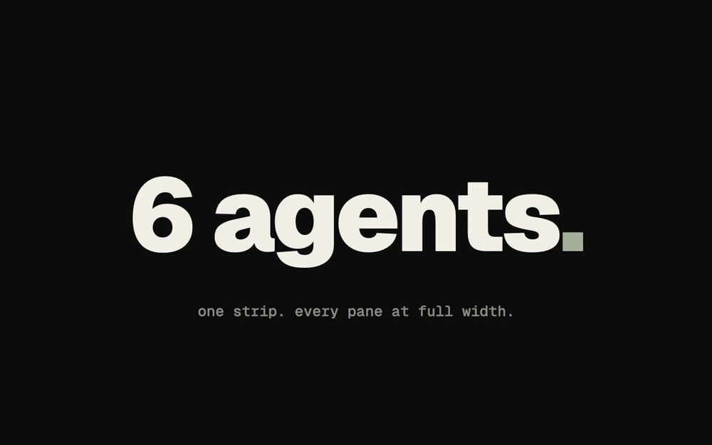
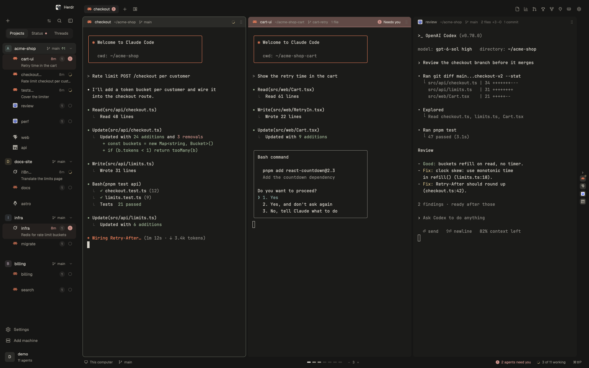

  

<h1 align="center">kansō</h1>

  
  
  
  

<b>More agents. Less babysitting.</b>

Every agent in a readable pane, the one waiting on you first, and a machine that lasts weeks. A layout for <a href="https://herdr.dev">Herdr</a>.

  

- Agents sit side by side, readable at their own width, and the one waiting on you comes first.
- Sleep a Claude Code agent, a tab or a whole project, and wake its Claude Code conversations where they were.
- Add another computer over your network or Tailscale. Its projects sit in the sidebar beside yours, and files, pictures, sleep, copy and paste work there too.
- Review pull requests, files, pictures and Markdown next to the agent that wrote them.
- Memory recycles idle Claude sessions so the machine lasts weeks. Spend adds up your AI work across computers once Sync is on. A Simulator sits beside the agent.

For the Herdr desktop app, not the Herdr TUI. macOS, Windows and Linux; the iOS simulator is macOS only.

  <a href="https://jlopezlira.github.io/herdr-kanso/">Website</a> ·
  <a href="#install">Install</a> ·
  <a href="#keys">Keys</a> ·
  <a href="#privacy">Privacy</a> ·
  <a href="CHANGELOG.md">Changelog</a>

## Install

Tell your agent: **`add herdr.dev/layouts/jlopezlira/herdr-kanso--kanso`**

Or, from a clone: `sh ./scripts/local-install.sh`. On Windows:
`powershell -NoProfile -File ./scripts/local-install.ps1`. You need the Herdr app;
`gh` for the PR and Shipped panels; Node 22.15 or newer for Spend, Memory and
Simulator. Memory supports macOS, Windows and Linux; Windows uses its built-in
PowerShell and Task Scheduler without administrator rights, and Linux a
systemd user timer. kansō updates
itself the same way on Windows, with Windows PowerShell and the curl and tar
that ship with Windows: a release shows as a row above Settings, and a click
installs it. Stable is what you get. Early, in Settings under Updates, also follows a beta
or a release candidate, and going back to Stable never installs an older
version. `ctrl-shift-l` goes back to your previous layout.
On Windows, merge `kanso/keys.windows.json` into your Herdr keys instead of
`kanso/keys.json`; on Linux, `kanso/keys.linux.json`.

## What it does

  <a href="https://jlopezlira.github.io/herdr-kanso/">
    <picture>
      <source media="(prefers-color-scheme: light)" srcset="site/shots/hero-light.png">
      
    </picture>
  </a>

- **A strip, not a grid.** Terminals keep their width; a new pane opens beside
  you and the view glides to it. A view holds 1 to 8 panes, 4 to start, and a
  full view starts the next page. Pin a column, stack a server under an agent.
  Cmd+F finds in the terminal, or in the whole conversation of a Claude Code or
  Codex agent on this computer.
- **Needs you first.** Cmd+J goes to the agent waiting on you, in any project.
  The sidebar shows every project you keep, every agent's state and what it is
  on, in three views: Projects, Status and Threads. Search finds any of them.
  After five minutes away, "While you were away" says what finished.
- **Sleep and wake.** A Claude Code agent, a tab or a project goes to sleep:
  each Claude Code agent exits with its conversation kept on its terminal and
  wakes on it in the same pane; other programs in the tab or project stop.
  Herdr keeps that, so another computer on the same space sees it asleep too,
  and waking from either works.
- **Your other computers.** Add a computer at the foot of the sidebar: kansō
  lists your Tailscale computers and your ssh hosts, Search this network adds
  the computers here that answer ssh, or an agent sets one up with you. It reaches a computer on the home
  network first and over Tailscale when you are away (Windows keeps the
  Tailscale route). When one asks for a password or a key's passphrase, Sign in
  opens a tab where you type it once, and kansō puts a key there so Herdr gets in
  on its own: the one in your ssh agent when there is one, otherwise its own
  `~/.ssh/id_ed25519_kanso`, which has no passphrase. Remove this computer's key,
  in the computer's menu, deletes the key kansō added there and removes the
  computer. A computer you disconnect stays in the sidebar,
  Asleep or Disconnected, until you remove it. Rename it, and the name shows on
  every computer.
- **Images.** The newest picture the agent in focus made, big beside it, and a
  square for each other picture. Click a square to switch. Click a spot to pin
  it and say what about it; ⌘↩ sends every note to the agent. Files, Preview
  and Images work for a space on another computer, and a note still sends.
- **Review without leaving.** Pull requests with diff, checks and threads, and
  one click to hand the feedback to an agent. Any file that is not a picture opens in Preview,
  and it can be edited when the read has no NUL and fits in 1 MiB, on this computer or another; `md-review plan.md` from an agent asks for your comments.
- **Tasks.** Your GitHub issues and your Jira Cloud and Linear tickets in one
  panel, a board per project in its own columns. Select one to read it, open it
  on GitHub or send it to an agent. Jira and Linear sign in with your own
  token, kept in your system's secret store and never in kansō.
- **While you are away.** An agent stopped by its plan limit can resume on its
  own when the limit resets. Schedule… in a project's menu starts an agent with a prompt at
  a time you choose, and New agent in a worktree gives one task to several
  agents. When every check on an agent's pull request has finished, the agent
  hears which failed.
- **Caffeine.** A panel that lists this computer and every connected one;
  Turn on keeps that computer working with its lid closed, on power or on
  battery, until you turn it off, its battery reaches 15% or it restarts.
  The first time, it asks for that computer's password once. On Windows it
  keeps the computer from idle sleep only.
- **Take over.** Open with… opens the pane's folder, worktree included, in your
  editor. Cmd+Alt+S hands a pane's work to another agent, or to every agent in
  a project. Cmd+Alt+T opens Arrangements: save the tab, then open it in any
  project.
  A terminal's right-click copies and pastes, on this computer or another.
- **What your agents leave running.** Ports: dev servers and the panes that
  run them, on every connected computer. Containers: Docker, with Up, Rebuild
  and Down per project. Worktrees: every one agents made, what removing it
  would lose, the disk back.
- **Weeks without a restart.** On macOS, Windows and Linux, the memory guard recycles
  bloated idle Claude agents on the same conversation; the Memory panel shows
  what it sees.
- **Spend and Shipped.** What your AI work is worth at list price, and how many
  of the pull requests you open reach production, period by period, with share
  images that carry totals only. Turn Sync on
  from another computer's row and Spend adds that computer's tokens.
- **The device beside the agent.** Simulator is kansō's own panel, using only
  Xcode's and Android's tools. It installs nothing. The iOS screen is a view;
  touch it in Apple's Simulator. Android keeps touch, typing and keys, with
  Rotate for emulators. Cmd+Shift+S opens it, Ctrl+Shift+S on Linux and
  Ctrl+Shift+M on Windows.
- **Keys you can see.** Cmd+? opens kansō help: your keys drawn on a keyboard,
  layer by modifier, a guide and what's new. The hjkl dōjō, a game for vim's
  moves with a pixel pet, has its own button in the tab bar.
- **Your layout, your pieces.** Settings, at the foot of the sidebar, rebinds
  kansō's keys and sets each piece of the window to show, show only when
  needed, or hide; hiding a piece stops the work behind it.
- Two themes, `kanso` and `kanso-day`.

## Keys

The table is the macOS keys. Windows ships its own in
`kanso/keys.windows.json`: Ctrl and Alt, leaving the Windows key and AltGr
alone. Linux ships `kanso/keys.linux.json`: Super where Omarchy leaves it free,
and Ctrl or Alt with Shift where Omarchy uses it. Help follows the bindings you have.
On Omarchy, kansō has Hyprland treat Herdr as a terminal: it writes
`~/.config/hypr/kanso.lua` and loads it from `hyprland.lua`. Then Super+C and
Super+V copy and paste in Herdr's terminals, on this computer or another, as in
Omarchy's other terminals. The Linux keys copy and paste with Ctrl+Shift+C and
Ctrl+Shift+V, and with Ctrl+Insert and Shift+Insert, which older Omarchy sends.
Ctrl+C still interrupts the program.

| Keys | What they do |
|---|---|
| Cmd+1 … Cmd+9 | Go to tab 1 to 9 |
| Ctrl+1 … Ctrl+9 | Go to project 1 to 9 |
| Ctrl+Alt+1 … Ctrl+Alt+9 | Go to column 1 to 9 |
| Cmd+Alt+Left and Cmd+Alt+Right | Previous and next pane |
| Cmd+Alt+H/J/K/L | Between panes, as vim; Shift moves the pane |
| Cmd+Alt+Shift+Left and Cmd+Alt+Shift+Right | Move the pane left and right |
| Cmd+D, Cmd+Alt+Shift+D, Cmd+Shift+D | New pane right, left, below |
| Cmd+Shift+W | Close the pane |
| Cmd+Shift+- and Cmd+Shift+= | Fewer or more panes per view |
| Cmd+Shift+Enter | Wider or narrower pane |
| Cmd+Alt+P | Pin the pane |
| Cmd+F | Find in the terminal, or in a Claude Code or Codex conversation |
| Cmd+Alt+S | Send the pane's work to another agent |
| Cmd+Alt+T | Arrangements: save this tab, or open a saved one |
| Cmd+J | Next agent that needs you |
| Cmd+Shift+Up and Cmd+Shift+Down | Agent above and below in the sidebar |
| Cmd+Shift+Left and Cmd+Shift+Right | Back and forward through the agents you visited |
| Ctrl+Alt+P, Ctrl+Alt+S, Ctrl+Alt+T | Projects, Status and Threads in the sidebar |
| Cmd+B | Show or hide the sidebar |
| Ctrl+Shift+1 … Ctrl+Shift+9 | Open panel 1 to 9 of the tab bar |
| Ctrl+Shift+, | kansō settings |
| Cmd+? | kansō help |
| Cmd+Shift+S | Simulator |

Every list answers j, k, gg, G, Enter, / and Esc. Settings, at the foot of the
sidebar, rebinds kansō's own keys and hides the panels you don't use.

## Privacy

Everything runs on your machine, and reads only the folders you work in:
`git`, `gh`, `find`, `du`, `lsof` (`ss` and `/proc` on Linux), `ps`, `sqlite3`, `node`, `docker`,
`xcode-select`, `simctl`, `adb`, `emulator`, the secret store's own tool (`security`,
`secret-tool` or `cmdkey`), Caffeine's `pmset`, `launchctl`, `systemd-run`
and `systemd-inhibit`, and Herdr's `hc`. What reaches the network: PR, Tasks and
Shipped through `gh`, only while their panel is shown; Tasks' Jira Cloud and Linear boards, only while the panel is
shown, with the token you gave each; the update check, `git ls-remote` on kansō's
GitHub repository, and the download of a release you install; Spend's daily
fetch of OpenRouter's price list; the hjkl dōjō's pet picker, which downloads
the agents' pets from persistent.oaistatic.com and codex-pets.net and keeps only
files whose checksum it knows;
Add a computer, which reads Tailscale's list of your computers and, unless
Settings turns it off, asks the computers this one already knows on the network
whether they answer ssh, and the whole network only when you press Search this
network. Another computer is reached only through Herdr's own connection to it.
Simulator's pictures and input stay on this computer. Threads and
Images read the agents' conversation files for the pictures
they printed; Spend reads the session files your AI tools write, for tokens and
prices. State lives under `~/.config/herdr-app/data/`. Nothing is sent to an
agent unless you press Send, and share images carry totals only.
[kanso/RECIPE.md](kanso/RECIPE.md) says what every part runs.

## Development

`npm test` (Node 22.15+, Git, Bash, sqlite3). Pull requests target `develop`.
A change to what kansō installs adds its entries under `## [Unreleased]` in
[CHANGELOG.md](CHANGELOG.md); a pull request never edits a numbered section or
`kanso/mods/kanso-chrome/version.json`, which the Release candidate workflow
sets. `npm run check:version -- --branch develop` checks it. Before a pull
request, `npm run pre-pr` runs every check and `npm test`. `npm test` also checks each mod's imports
against the Herdr names in `tests/herdr-api.json` (`node scripts/herdr-api.mjs`
rewrites that file from this machine's declarations), and `npm run check:mods`
runs `herdr-app check` on every mod when the app is installed. A push
to `develop` publishes `vX.Y.Z-beta.N`, once CI passes on all three platforms,
when what kansō installs changed since the last beta or the newest stable tag. Running the Release candidate workflow
on `develop` publishes `vX.Y.Z-rc.N`. Merging `develop` into `main` publishes
the stable `vX.Y.Z`. Docs do not bump the version. How to work on it:
[CONTRIBUTING.md](CONTRIBUTING.md). How every part is built:
[kanso/RECIPE.md](kanso/RECIPE.md).

## Credits and license

The idea of a simulator panel beside the agent came from herdr-sim by Robert Soriano.

Grown out of the mods shipped with Herdr; [NOTICE](NOTICE) says who changed
what. Contributors: Iván Campaña ([icampana](https://github.com/icampana)),
Leangseu Kim ([leangseu](https://github.com/leangseu), pull request prompts),
Johannes Hund ([h0ru5](https://github.com/h0ru5), markdown reviews),
Jericho Siahaya ([jerichosiahaya](https://github.com/jerichosiahaya), Spend's source toggles) and
Fabian ([SiliconKaiser](https://github.com/SiliconKaiser), the Markdown panel over SSH report).
Apache License 2.0: [LICENSE](LICENSE).
