# Kanso

**Your agents in a row, not a grid.**

Kanso is a layout for [Herdr](https://herdr.dev) made for running many coding
agents and still reading everything they write. Every terminal keeps its width
on a strip you slide along. The diff, the pull request and your editor sit
beside them.

<picture>
  <source media="(prefers-color-scheme: light)" srcset="docs/screenshots/hero-light.png">
  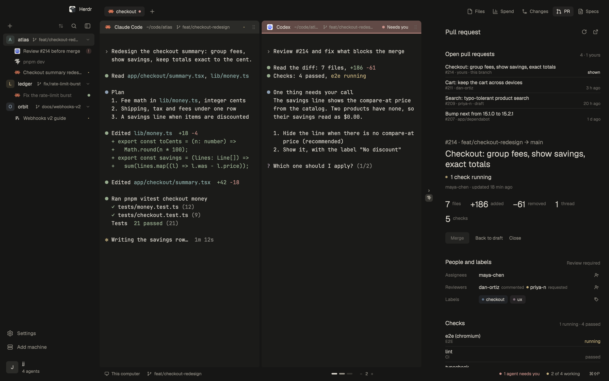
</picture>

> **Install:** tell your agent **`add herdr.dev/layouts/jlopezlira/kanso`**
>
> [Manual install](#install) · [Keys](#keys) · [What it runs](#privacy-what-it-runs)

## Why Kanso

- **Read every agent.** Terminals sit on a horizontal strip and keep their
  width. A new pane opens beside the one you are in and the view glides to it.
  Nothing gets squeezed into a grid.
- **Review without leaving.** Files, Changes and pull requests open beside your
  agents: diffs, CI, unresolved threads, merge. One click starts an agent on a
  pull request's feedback.
- **Take over in one key.** Cmd+Shift+O opens the agent's folder, its worktree
  included, in Cursor, VS Code, Zed, or Neovim in a split.
- **Light on your machine.** Panels exist only while open, and the Files tree
  draws only the rows you can see. [Measured](benchmarks/README.md): 78% less
  CPU on a 500-row tree.

What you need: the Herdr app, and the GitHub CLI (`gh`) for the pull request
panel. Spend and Specs are optional integrations, not part of Kanso.

## The tour

### Every terminal keeps its width

Panes live on an endless horizontal canvas. Pick **1 to 8 columns per view**,
resize them, and move through the work without squeezing every terminal onto one
screen. **Pin a column** to keep it in view while the rest slides. **Stack
panes** to keep a server, tests or a second agent beside the task. A rail at
the edge shows what is off screen, and a minimap keeps your place.

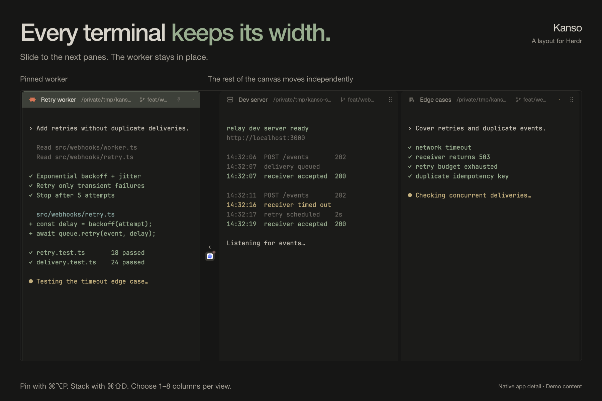

<details>
<summary>See pinning, navigation and stacking in three captured states</summary>

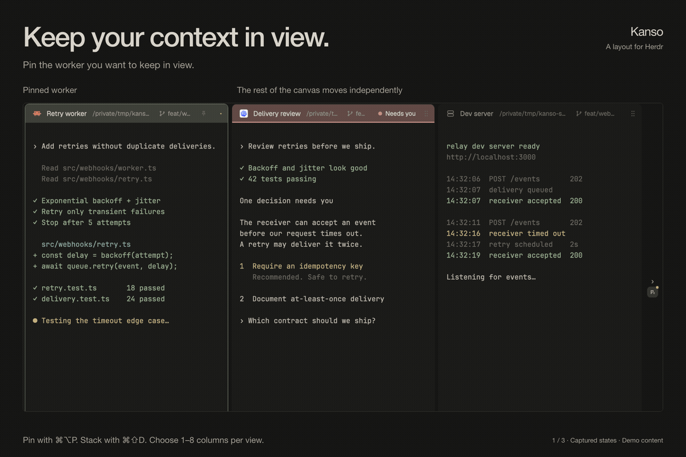

These are native app captures with edited timing, not a frame-rate demonstration.

</details>

### Turn review feedback into the next task

Browse **every open pull request** in the repository. Read the description and
diff, check CI and unresolved threads, manage reviewers and labels, and merge
from the panel. Then **ask your agent** to explain the pull request, address its
feedback or resolve its conflicts. The task opens in a new tab with the context
already in the prompt.

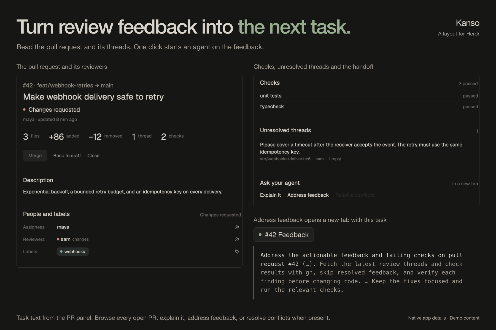

### The agent's work, your editor

**Open with** (Cmd+Shift+O, or the pane header's button) opens the focused
agent's current folder, its Git worktree included, in your editor. You land in
the workspace the agent is actually using. From **Files** or a file preview it
opens that file instead.

The picker detects your installed editors and puts recent choices first. Choose
with **1 to 9**, the arrow keys or Enter. Cursor, VS Code, Zed, Windsurf,
Antigravity, Kiro, Sublime Text, JetBrains IDEs and Xcode open as apps;
**Neovim, Helix and Vim open in a split** beside the agent. Remote workspaces
open over SSH in compatible VS Code-family editors and Zed. A text file can also
be previewed in the panel, with no editor at all.

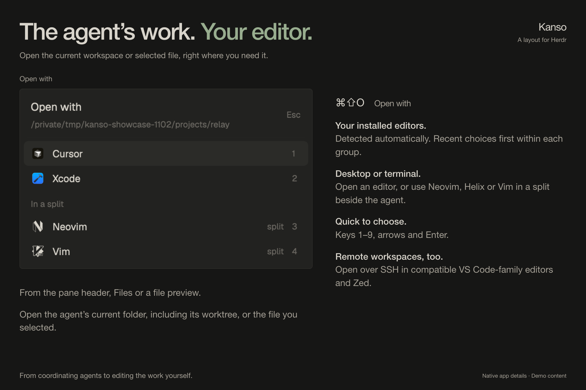

<details>
<summary>See a rendered document beside the editor picker</summary>

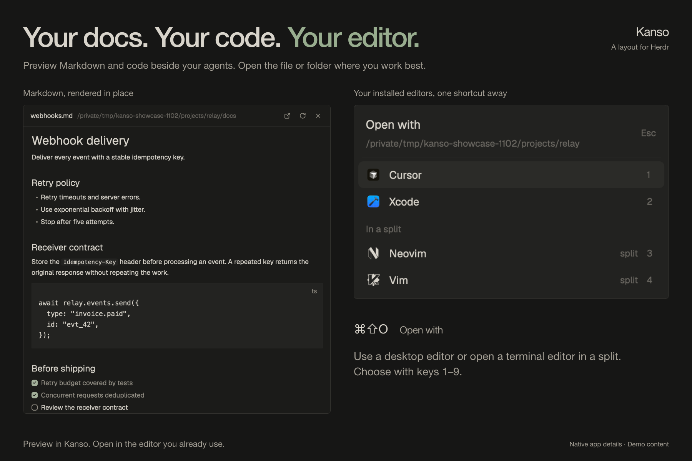

</details>

### Read the diff, make the commit

The **Changes** panel puts changed files, inline diffs and a commit message next
to your agents while they keep working. The **Files** panel previews code and
renders Markdown, including code blocks and checklists.

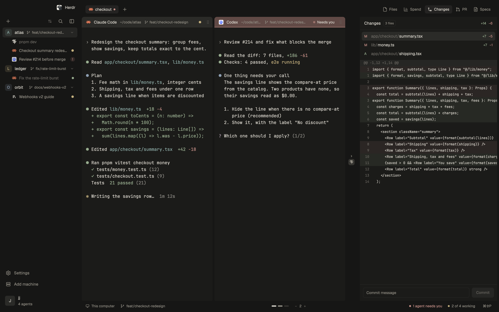

### See what you shipped

**Shipped** is Spend's other half: what you delivered by day, week, month or
year. It shows the lines that landed, compared with the same point of the
period before, along with pull requests merged, commits, reviews, your streak
with twelve weeks of contributions, your records, and where it all went, by
repository. When you set a new record, it tells you.

### Every repo and worktree, one sidebar

Repositories and their **nested Git worktrees** sit together, each with its
branch and sessions: agents, shells and dev servers. Group work by local or
remote machine. Order sessions by **Needs you first**, last update, kind, screen
position or your own drag order. Pin the important ones and rename anything.

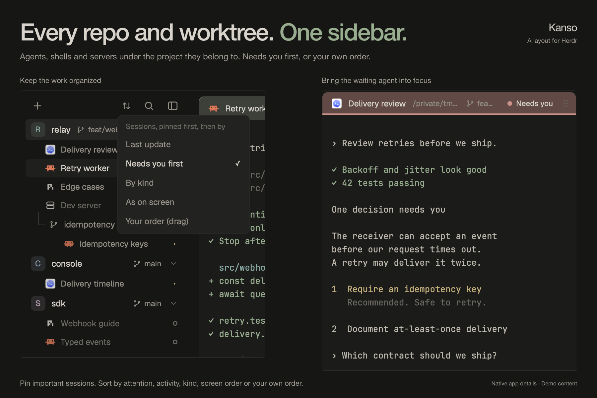

### Light on your machine

Side panels are mounted only while open. Background Git checks slow down when
the window is behind others. The Files tree draws only the visible rows, and the
canvas avoids rendering off-screen panes.

On an Apple M4 with Herdr 0.1.11, against Kanso before its performance work:
**78% less CPU for a 500-row Files tree** and **74.7 ms to list a 50,000-file
folder**. These are targeted measurements, not whole-app or battery-life claims.
[Benchmark conditions and results](benchmarks/README.md).

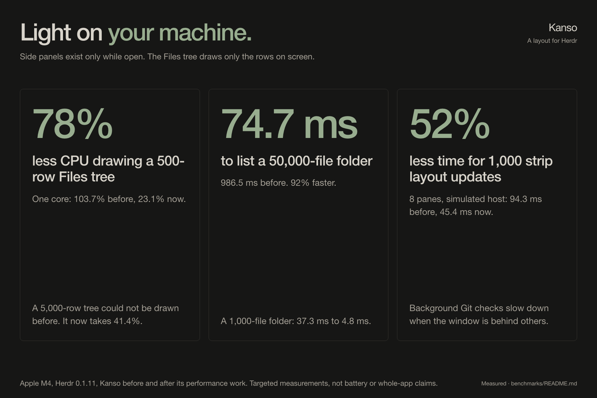

### Keyboard first, mouse friendly

Every move has a key, and panes also drag, resize and pin with the mouse.
[All shortcuts and gestures](#keys).

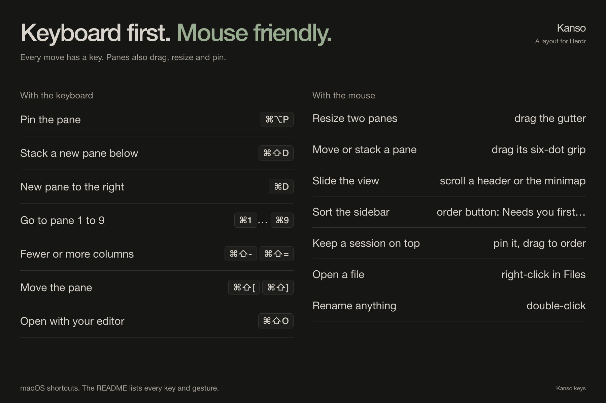

### Light and dark

Kanso ships two themes: `kanso` (dark) and `kanso-day` (light), in warm stone
greys with color only where it helps you act.

<details>
<summary>See Kanso Day</summary>

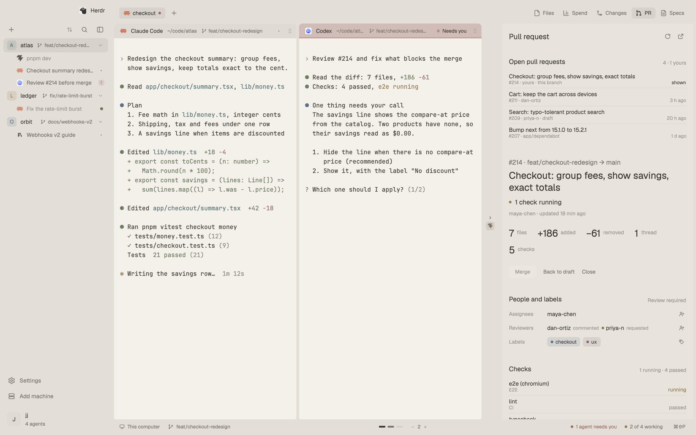

</details>

The images use native Herdr captures with staged repositories, terminal output
and pull request data. Spend and Specs, visible in the tab bar, are optional
integrations.

Kanso is the Japanese principle of simplicity: remove what is not needed. If it
saves you time, [a star](https://github.com/jlopezlira/herdr-kanso) helps other
Herdr users find it.

## Install

Ask your agent: "add herdr.dev/layouts/jlopezlira/kanso". Or by hand, from a
clone of this repository:

```sh
cp kanso/layouts/kanso.json ~/.config/herdr-app/layouts/
cp kanso/layouts/kanso.png  ~/.config/herdr-app/layouts/
cp kanso/themes/*.json      ~/.config/herdr-app/themes/
cp -R kanso/mods/kanso-* kanso/mods/open-with ~/.config/herdr-app/mods/
# then add the "layout:kanso" section of kanso/keys.json to ~/.config/herdr-app/keys.json
herdr-app do layout.switch --name kanso
```

`ctrl-shift-l` switches back to your previous layout. Deleting the files
removes Kanso. Light and dark themes are included (`kanso-day`, `kanso`).

### Updates

Kanso updates itself, apart from Herdr. Herdr's own updates keep their dot on
Settings; Kanso's show as their own row, **Update Kanso to X**, above
Settings, and a toast once per version. Every 6 hours the sidebar footer looks
up this repository's `vX.Y.Z` tags with `git ls-remote`. Clicking the row (or
the toast) downloads that release, runs `herdr-app check` on each mod, and
only then swaps the mod folders whole and copies the themes. Your layout and
keys change only where the release changed them: a key you set yourself is
never replaced, and if the layout changed, the one you had is kept as
`layouts/kanso.json.old-<time>`. Installs from before 1.1.0 have no updater:
update those once by hand as above.

## Keys

| Keys | What they do |
|---|---|
| Cmd+1 ... Cmd+9 | Go to pane 1 to 9 |
| Cmd+[ and Cmd+] | Previous and next pane (the view glides to it) |
| Cmd+D, Cmd+Alt+D, Cmd+Shift+D | New pane right, left, below (stacked) |
| Cmd+Alt+Up/Down | Move the focus within a stack |
| Cmd+W | Close the pane |
| Cmd+Shift+[ and Cmd+Shift+] | Move the pane left and right |
| Cmd+Shift+- and Cmd+Shift+= | Fewer or more panes per view (1 to 8) |
| Cmd+Shift+0 | Even the panes out |
| Cmd+Shift+Enter | Make the pane wider or narrower |
| Cmd+Shift+O | Open the pane's folder in a code editor |
| Cmd+Alt+P | Pin the pane: it keeps its place and stays in view |

With the mouse:

| Do this | To |
|---|---|
| Drag the gutter between two panes | Resize them, sideways or up and down |
| Hold a pane's six-dot grip and drag it onto another | Move it: the left or right quarter makes a column before or after, the middle stacks it above or below |
| Scroll over a header or the minimap | Slide the view |
| Use the order button at the top of the sidebar | Sort each space's sessions by last update, needs you first, kind, screen order, or your own |
| Hover a session and click its pin | Keep it at the top of its space; drag pinned ones to order them |
| Right-click a file in the Files panel | Open it in an editor, or preview it in the panel |
| Double-click a session, a pane header, a space or a tab | Rename it (an empty name brings the automatic one back) |

## Privacy: what it runs

The mods run `git` (the spaces list, Files, Changes), `find` (listing a folder
on Unix, with `bash` as a fallback) and `hc machine ls` (machines). They read
files only inside the folders you work in.

Three things reach the network. The pull request panel runs the GitHub CLI
(`gh`) and talks to GitHub only while the panel is shown. So does Shipped,
which reads your contributions and merged pull requests from GitHub with `gh`
and runs `git log` in the repositories you work in, only while it is shown. The updater runs
`git ls-remote` against this repository every 6 hours, and only when you
choose to update downloads the release with `curl` into
`~/.config/herdr-app/.kanso-update/`, removed when it is done. Open with runs `sh`
to find installed editors (app folders, `command -v`, `flatpak`); on macOS it
opens an editor with `open -a` and caches each app's icon under
`~/.config/herdr-app/data/open-with/`.

Specs (`sdd-focused`) and Insights are optional: install either mod and its
button appears in the tab bar. Install them while another layout is shown:
the first time Herdr sees a mod folder it docks a copy into the layout on
screen, so installing `token-spend` (`"place": "right"`) while Kanso is shown
leaves a second Spend panel at the window's right edge. If that happened,
remove the `token-spend` block from the root of `layouts/kanso.json`.

## Development

```sh
npm test                               # Node.js 20+, Git and Bash; macOS or Linux
npm run bench -- --base origin/main    # macOS, with the Herdr app installed
```

The tests load each mod's real code into a fake Herdr host and run it against
real temporary Git repositories and folders. The benchmark compares a git ref
with your working tree in isolated native Herdr windows; see
[benchmarks/README.md](benchmarks/README.md).

Versioning: any pull request that changes what Kanso installs (`kanso/mods`,
`kanso/themes`, `kanso/layouts`, `kanso/keys.json`) bumps
`kanso/mods/kanso-chrome/version.json` and adds that version's section to
[CHANGELOG.md](CHANGELOG.md). The bump is semantic and follows from what the
section lists: Breaking or Removed means major, Added or Deprecated means
minor, and anything else means patch. `npm run check:version` checks this, and
CI runs it on every pull request. Merging to main tags and releases the new
version with its changelog section as the notes
(`.github/workflows/release.yml`), and that release is what the updater
offers.

How every part is built, in enough detail to rebuild it:
[kanso/RECIPE.md](kanso/RECIPE.md). `herdr-app check kanso/mods/<mod>` loads a
mod once and reports what is wrong.

## Credits

The mods grew out of the ones shipped with Herdr, through the 0oz-design fork
and the minimalistic layout; [NOTICE](NOTICE) and each file's header say who
changed what.

Contributors: Iván Campaña ([icampana](https://github.com/icampana)), who found
and fixed the layout writers saving another layout's tree into kanso.json.

## License

Apache License 2.0. See [LICENSE](LICENSE) and [NOTICE](NOTICE).
