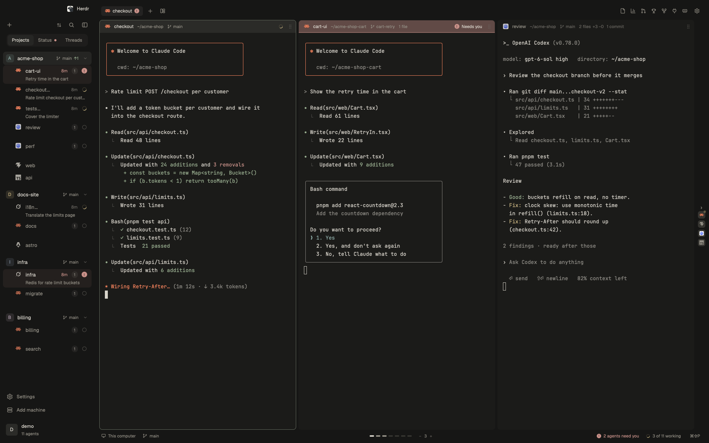

<p align="center">
  <a href="https://jlopezlira.github.io/herdr-kanso/"></a>
</p>

<h1 align="center">kansō</h1>

<p align="center"><b>More agents. Less babysitting.</b></p>

<p align="center">Every agent gets a readable pane, the one waiting on you comes first, and idle Claude Code sessions recycle on the same conversation so your machine lasts weeks. A layout for <a href="https://herdr.dev">Herdr</a>.</p>

<p align="center">
  <a href="https://jlopezlira.github.io/herdr-kanso/">Website</a> ·
  <a href="#install">Install</a> ·
  <a href="#keys">Keys</a> ·
  <a href="#privacy-what-it-runs">What it runs</a> ·
  <a href="CHANGELOG.md">Changelog</a>
</p>

<p align="center">
  <a href="https://jlopezlira.github.io/herdr-kanso/">
    <picture>
      <source media="(prefers-color-scheme: light)" srcset="site/shots/hero-light.png">
      
    </picture>
  </a>
</p>

> **Install:** tell your agent **`add herdr.dev/layouts/jlopezlira/herdr-kanso--kanso`**
>
> [Manual install](#install) · [Keys](#keys) · [What it runs](#privacy-what-it-runs)

## Why kansō

- **Read every agent.** Terminals sit on a horizontal strip and keep their
  width. A new pane opens beside the one you are in and the view glides to it.
  Nothing gets squeezed into a grid.
- **Review without leaving.** Files and pull requests open beside your
  agents: diffs, CI, unresolved threads, merge. One click starts an agent on a
  pull request's feedback.
- **Take over in one key.** Cmd+Shift+O opens the agent's folder, its worktree
  included, in Cursor, VS Code, Zed, or Neovim in a split.
- **Light on your machine.** Panels exist only while open, and the Files tree
  draws only the rows you can see. [Measured](benchmarks/README.md): 78% less
  CPU on a 500-row tree.

What you need: the Herdr app, the GitHub CLI (`gh`) for the pull request and
Shipped panels, and Node 22.15 or newer for Spend.

## The tour

### Every terminal keeps its width

Panes live on an endless horizontal canvas. Pick **1 to 8 columns per view**,
resize them, and move through the work without squeezing every terminal onto one
screen. **Pin a column** to keep it in view while the rest slides. **Stack
panes** to keep a server, tests or a second agent beside the task. A rail at
the edge shows what is off screen, and a minimap keeps your place.


<details>
<summary>See pinning, navigation and stacking in three captured states</summary>


These are native app captures with edited timing, not a frame-rate demonstration.

</details>

### Turn review feedback into the next task

Browse **every open pull request** in the repository. Read the description and
diff, check CI and unresolved threads, manage reviewers and labels, and merge
from the panel. Then **ask your agent** to explain the pull request, address its
feedback or resolve its conflicts. The task opens in a new tab with the context
already in the prompt.


### The agent's work, your editor

**Open with** (Cmd+Shift+O, or the pane header's button) opens the focused
agent's current folder, its Git worktree included, in your editor. You land in
the workspace the agent is actually using. From **Files** or a file preview it
opens that file instead.

The picker detects your installed editors and puts recent choices first. Choose
with **1 to 9**, the arrow keys or Enter. Cursor, VS Code, Zed, Windsurf,
Antigravity, Kiro, Sublime Text, JetBrains IDEs and Xcode open as apps;
**Neovim, Helix and Vim open in a split** beside the agent. Remote workspaces
open over SSH in compatible VS Code-family editors and Zed. A text file can also
be previewed in the panel, with no editor at all.


<details>
<summary>See a rendered document beside the editor picker</summary>


</details>

### Read your files

The **Files** panel previews code, and
opens a Markdown file formatted, to read and edit where it reads: double-click
a paragraph, a list, a heading or a table to edit just that block; what you
type is saved as you go, and never over a change an agent made meanwhile. On
macOS, `sh ~/.config/herdr-app/mods/kanso-tabs/markdown-handler.sh install`
makes `.md` files open there from a Cmd-click in a terminal or Finder (and
`uninstall` gives them back); nothing changes until you run it. The same
editor is a window over any layout as the
[markdown-panel](markdown-panel/RECIPE.md) mod.

### See what you shipped

**Shipped** is Spend's other half, and its numbers are meant to make you feel
good. It counts what you delivered across every repository and organization,
by day, week, month or year:
- lines added and removed, with how much you grew against the period before;
- contributions (private ones included), pull requests merged, commits,
  reviews and repositories;
- your totals since you joined GitHub;
- your streak, with a heat map that fills the panel, up to a whole year;
- your records, with a toast when you set a new one;
- when in the day you ship, and from which machine;
- every repository you shipped to.

**Share** turns it into an image to post on X, LinkedIn or Bluesky, the same
way Spend does. The image has only the global numbers, never the names of your
repositories or machines. The composer opens with the words written and the
image pasted in, for you to check and post. On macOS the paste needs Herdr in
System Settings > Privacy & Security > Accessibility; without it the image
waits on the clipboard for Cmd-V. Chrome, Chromium, Brave or Edge draws it (or
`rsvg-convert`, or QuickLook on macOS), and a copy stays in Downloads.

Your machines fill in what GitHub can't see. Each one reads its own git: every
branch, every identity you commit with, even an email GitHub can't link to
you. They share what they read through a private gist, and Shipped keeps only
statistics.

### Clean up the worktrees agents leave behind

Agents make a worktree for every task, review and audit, and seldom remove it.
The **Worktrees** panel finds every one on your computer: under the top folders
of your spaces (`~/Apps` for `~/Apps/acme/web`), wherever each repository says
they are (temp folders and agent scratchpads included), and the folders left
behind when a repository moved or was deleted. It shows how much disk they
take, grouped by repository, and what each one holds:
- **merged**: its work is already in the default branch or `develop`, squash
  merges included;
- **not merged**: its commits stay on its branch when the folder goes;
- **uncommitted changes**, or **commits only here** (a detached HEAD no branch
  has): the only work removing it would lose;
- **in use today** or **open in Herdr**: left alone.
- **repository moved**: its `.git` still names the old place, so git can't read
  it. It is never removed; **Repair the link** (`git worktree repair`) connects
  it again, and then it is checked like any other.

Each one is checked again right before it goes: one that changed since the
scan (new work, an agent at work there, a link that broke) stays, and the panel
says why instead of failing. A folder made again as a repository of its own
keeps its files; only the old worktree record goes.

**Clean up** removes, after a second press, every one that loses nothing and
has been idle a day, and deletes the branches already merged. A row opens what
it holds, to open it in a new tab or remove it; **Remove all** does a whole
repository, and says first what would be lost. Records of folders already gone
are pruned the same way.

**Freed** keeps score, from a history in SQLite: every worktree the panel has
seen is kept once and rewritten only when it changes, and one that disappears,
removed here or anywhere else, stays with the size it freed. It shows how much
disk was freed, the worktrees, merged branches and leftovers cleared, and a bar
a day for the last 30 days, of what was freed and of what the worktrees took.
**Where the space is** splits the disk by what can be done with it (can go,
needs a look, in use, left behind) and ranks the repositories that take the
most.
The panel opens on the last scan while it checks everything again. **Share**
posts it to X, LinkedIn or Bluesky as an image, the same way Shipped and Spend
do, with the totals only: never a repository, branch or folder name. Before
anything is freed, it shares what the worktrees take. **Explain it** on a worktree, or **Review the ones that
need a look**, hands the question to your agent in a new tab: what that work
is, whether it already lives in a branch, a remote or a pull request, and what
to keep. The agent explains; it changes nothing.

### Go where you're needed

**Cmd+J** takes you to the next agent waiting on you, in any space: one
blocked on a question first, then one that finished while you weren't
looking. Press it again for the one after. "2 agents need you" in the status
bar does the same on a click.

When an agent stops working, its pane header says what it left in its
folder, in one quiet line: changed files with lines added and removed, the
commits its branch has that the upstream doesn't, and its open pull request
with a dot for the checks (green passing, yellow running, red failing). It
comes from `git` and `gh` once per turn, never from the agent's conversation.

### Hand the work to another agent

**Send to an agent** (the pane header's send button, the pane menu, or
Cmd+Alt+S) passes a pane's work to another agent: Claude writes, Codex
reviews. Pick the agent, read the message (it starts as "Review the changes
on branch feat/login in ~/Apps/web") and edit it. **Send** pastes it into
that agent's terminal and presses Enter, as if you typed it there, then
takes you to it. Nothing is added to what the agent sees, and an agent
waiting on its own question is never typed into.

### Your tab, the way you set it up

**Arrangements** (the layers button beside +, or Cmd+Alt+T) keeps the tab
you set up every morning: which program runs in each pane with the flags you
started it with (`claude --model opus`, `codex -m gpt-5.5`, `npm run dev`),
its folder, the columns, the stacks and their widths. Save this tab, and open
it again in a new tab with one click. Arrangements belong to the project
(the space's folder), so Shield can open a Sonnet lead beside an Opus
developer while Fluenty opens something else. kansō adds nothing of its own,
and a resumed session's id is left out, so each agent starts fresh.

### Servers left running

The **Ports** panel lists the dev servers listening on this computer: the
port, the command, its folder, how long it has run, and the pane that runs
it. Agents start servers and leave them running when their pane closes; the
ones no pane runs any more are marked, and **Stop** (a second press
confirms) ends them, with a force stop for one that won't go. Open one in
the browser or go to its pane from the same row. With the memory guard on,
each row shows the memory it holds, and the panel keeps a history: how many
ran at once over 24 hours, 7 or 30 days (the ones with no pane marked), what
opened today, what ended and how, and what stopping them gave back.

### Docker, simply

The **Containers** panel answers what Docker is doing on this computer. First,
how much memory Docker and its VM hold, which they keep even with nothing
running; **Quit Docker** (a second press confirms) gives it back. Then every
container, grouped by the Kanso project it is for (its compose folder, else
its name): its state, memory, ports (a click copies `localhost:<port>`) and
how long it has run, with Start, Stop, Restart, Shell, Open (a web port),
Logs, Details (ports, mounts, networks, restart policy, environment names)
and Remove for a stopped one. A project has Start all and Stop all, and its
compose files show with **Up**, **Rebuild** and **Down** even before anything
runs. **Pull** takes an image by name and **Run…** starts one with a name and
a port; images and volumes list what uses each, with Remove unused, and the
build cache can be cleared. Pulls, compose, shells and logs run in a tab of
their own. When Docker isn't running, the panel says so and opens it.

### Weeks without a restart

The **Memory** panel shows what the memory guard sees in a long session: how
much of the machine is free, with a chart over 24 hours, 7 or 30 days; the
window, herdr-core and every agent's footprint, each agent with its last 14
days; the heaviest processes on the machine; and what the guard did about it.
An idle Claude agent that grew too large is **recycled**: ended with `/exit`
and started again in the same terminal with `--resume`, so the conversation
carries on in a fresh process. From the panel you can recycle one, restart the
window or end hung helpers (a second press confirms each), and turn the guard
on when it is off.

### Every repo and worktree, one sidebar

Repositories and their **nested Git worktrees** sit together, each with its
branch, its agents and its other terminals (shells, dev servers). Each agent
shows how long it has been working, waiting on you or done, and under its name
what it says it is on: the step it reports as it works and its last words when
it finishes (else its title, or what it left in git). A step that takes long
shows its time; a count says what still runs under an agent that stopped; the
agents it started sit under it.
Three views at the top of the sidebar: **Projects** (each project with its
agents), **Status** (every agent in every project by what it needs from you:
Needs you, Working, Done, Idle) and **Threads**, your conversations as T3
Code keeps them: each named by the title its agent gives it, kept up to date,
with your last message; pin, settle, snooze, mark unread, rename, and a
right-click for the rest. The sort button sorts in each view's terms. Group work by local or
remote machine. Order agents by **Needs you first**, last update, kind, screen
position or your own drag order. Pin the important ones and rename anything.
What changes eases into place natively (the view switch slides, the selection
glides to the row you click, agents fold by height), and a working agent's
ring keeps turning behind other windows, so a glance tells you it still is.


### Light on your machine

Side panels are mounted only while open. Background Git checks slow down when
the window is behind others. The Files tree draws only the visible rows, and the
canvas avoids rendering off-screen panes.

On an Apple M4 with Herdr 0.1.11, against kansō before its performance work:
**78% less CPU for a 500-row Files tree** and **74.7 ms to list a 50,000-file
folder**. These are targeted measurements, not whole-app or battery-life claims.
[Benchmark conditions and results](benchmarks/README.md).


### Keyboard first, mouse friendly

Every move has a key, and panes also drag, resize and pin with the mouse.
[All shortcuts and gestures](#keys).


### Light and dark

kansō ships two themes: `kanso` (dark) and `kanso-day` (light), in warm stone
greys with color only where it helps you act.

<details>
<summary>See kansō day</summary>


</details>

The images use native Herdr captures with staged repositories, terminal output
and pull request data. They predate 2.0, whose tab bar shows the panels as
icons and no longer offers Specs.

kansō is the Japanese principle of simplicity: remove what is not needed. If it
saves you time, [a star](https://github.com/jlopezlira/herdr-kanso) helps other
Herdr users find it.

## Install

Ask your agent: "add herdr.dev/layouts/jlopezlira/herdr-kanso--kanso". Or by hand, from a
clone of this repository:

```sh
cp kanso/layouts/kanso.json ~/.config/herdr-app/layouts/
cp kanso/layouts/kanso.png  ~/.config/herdr-app/layouts/
cp kanso/themes/*.json      ~/.config/herdr-app/themes/
cp -R kanso/mods/kanso-* kanso/mods/open-with ~/.config/herdr-app/mods/
# then add the "layout:kanso" section of kanso/keys.json to ~/.config/herdr-app/keys.json
herdr-app do layout.switch --name kanso
```

Only want the editor picker? **Open with** is also listed on its own: ask your
agent to "add herdr.dev/mods/jlopezlira/herdr-kanso--open-with" to add it to the
layout you already use, or copy `open-with/mods/open-with` to
`~/.config/herdr-app/mods/` and merge `open-with/keys.json` into yours.

`ctrl-shift-l` switches back to your previous layout. Deleting the files
removes kansō. Light and dark themes are included (`kanso-day`, `kanso`).

### Updates

kansō updates itself, apart from Herdr. Herdr's own updates keep their dot on
Settings; kansō's show as their own row, **Update kansō to X**, above
Settings, a dot on the gear at the end of the tab bar, and a toast once per
version, even with the sidebar hidden. When Herdr starts, and every 5 minutes
after, the tab bar looks up this repository's `vX.Y.Z` tags with
`git ls-remote`, which is one small request with no API quota, so a release
shows within minutes. `herdr-app do kanso-tabs.check` (or a key bound to
`kanso-tabs.check`) looks right away and says whether you are up to date. Clicking the row (or
the toast) downloads that release, runs `herdr-app check` on each mod, and
only then swaps the mod folders whole and copies the themes. Your layout and
keys change only where the release changed them: a key you set yourself is
never replaced, and if the layout changed, the one you had is kept as
`layouts/kanso.json.old-<time>`. Installs from before 1.1.0 have no updater:
update those once by hand as above.

## Keys

| Keys | What they do |
|---|---|
| Cmd+1 ... Cmd+9 | Go to pane 1 to 9 |
| Cmd+[ and Cmd+] | Previous and next pane (the view glides to it) |
| Cmd+D, Cmd+Alt+D, Cmd+Shift+D | New pane right, left, below (stacked) |
| Cmd+Alt+Up/Down | Move the focus within a stack |
| Cmd+W | Close the pane |
| Cmd+Shift+[ and Cmd+Shift+] | Move the pane left and right |
| Cmd+Shift+- and Cmd+Shift+= | Fewer or more panes per view (1 to 8) |
| Cmd+Shift+0 | Even the panes out |
| Cmd+Shift+Enter | Make the pane wider or narrower |
| Cmd+Shift+O | Open the pane's folder in a code editor |
| Cmd+Alt+P | Pin the pane: it keeps its place and stays in view |
| Cmd+J | Go to the next agent that needs you, in any space |
| Cmd+Alt+H/J/K/L | Vim's left, down, up, right between panes; left of the first pane is the sidebar's list |
| Cmd+Alt+Shift+H/J/K/L | Move the pane left, down, up, right |

In the sidebar's list, and in every kansō menu and list: J and K (or the
arrows) move, GG and Shift+G go to the first and the last, Enter opens, L
opens too in the sidebar, / searches, Esc goes back to the pane you came
from (Cmd+Alt+L as well).

Cmd+? opens kansō help: your keys drawn on a keyboard, layer by modifier,
and the way into the **hjkl dōjō**, a game to learn vim's moves with Hachi, a pixel shiba.
| Cmd+Alt+S | Send the pane's work to another agent |
| Cmd+Alt+T | Arrangements: save this tab, or open a saved one |

With the mouse:

| Do this | To |
|---|---|
| Drag the gutter between two panes | Resize them, sideways or up and down |
| Hold a pane's six-dot grip and drag it onto another | Move it: the left or right quarter makes a column before or after, the middle stacks it above or below |
| Scroll over a header or the minimap | Slide the view |
| Use the order button at the top of the sidebar | Sort each space's agents by last update, needs you first, kind, screen order, or your own; turn the activity line or the Projects, Status and Threads switch off |
| Click Projects, Status or Threads at the top of the sidebar | See your agents by project, by what they need from you, or as conversations named on their own |
| Click the gear at the end of the tab bar, or ⌃⇧, | kansō settings: kansō's own keys only (⌃⇧1-9 panels, ⌃⌥1-9 pane columns, ⌃⌥P/S/T views; panes, tabs and spaces keep Herdr's keys), rebound by pressing; hide the panels and pieces you don't use; read what's new; see who makes it |
| Hover an agent and click its pin | Keep it at the top of its space; drag pinned ones to order them |
| Hover a panel icon at the top right | See its name; the open panel always shows it |
| Press a panel icon and let go on another | Move it there |
| Right-click a panel icon | Open Panels: drag them into order, and turn each one on or off |
| Right-click a file in the Files panel | Open it in an editor, or preview it in the panel |
| Double-click an agent, a pane header, a space or a tab | Rename it (an empty name brings the automatic one back) |

## Privacy: what it runs

The mods run `git` (the spaces list, Files), `find` (listing a folder
on Unix, with `bash` as a fallback) and `hc machine ls` (machines). They read
files only inside the folders you work in.

Three things reach the network. The pull request panel runs the GitHub CLI
(`gh`) and talks to GitHub only while the panel is shown. So does Shipped,
only while it is shown. Through `gh` it reads your contribution counts and
each repository's weekly contributor statistics, and it keeps a private gist
of yours, "Kanso Shipped stats", with one file per machine. It also runs
`git log` in your repositories on this machine (those of your panes and
spaces, and under `~/Apps`, `~/Projects` and similar folders, 4 levels deep).

All of it lives in `~/.config/herdr-app/data/kanso-panel/shipped.db`, through
the `sqlite3` command, and only as statistics. For each commit that is its
repository, hash, time, lines added and removed, and machine. No messages,
file names or code. Open with runs `sh`
to find installed editors (app folders, `command -v`, `flatpak`); on macOS it
opens an editor with `open -a` and caches each app's icon under
`~/.config/herdr-app/data/open-with/`.

Worktrees runs `find`, `git` and `du` on this machine only: under the top
folders of your spaces and in `/tmp`, and in each repository it finds. It keeps
the worktrees' folders, repositories, branches, sizes and what they hold in
`~/.config/herdr-app/data/kanso-panel/worktrees.db` (`sqlite3`), and removes
only what you confirm. Its share image has totals only.

The pane headers run `git` and `gh pr view` in an agent's folder when it
stops working, and keep only the counts. Send to an agent runs `hc send`, and
only when you press Send. Arrangements run `hc get` to read what each pane
runs and keep it in `~/.config/herdr-app/data/kanso-arrange.json`. Ports runs
`lsof`, `ps` and `hc get` on this computer only while the panel is shown,
reads the guard's `~/.config/herdr-app/data/kanso-guard/ports.json`, and stops
only what you confirm (through the guard, or with `kill` without it).

The sidebar's Threads view, only while it is shown, finds the conversation
of each agent on this computer: `hc get` names the program in front of its
terminal, then it reads `~/.claude/sessions/<pid>.json` (Claude Code) or asks
`lsof` which conversation file a Codex process holds, and
`~/.codex/session_index.jsonl` for Codex's name for it. From the
conversation file (`~/.claude/projects`, `~/.codex/sessions`) it reads, with
`grep`, `head` and `tail`, the title the agent gave it and your first and
last messages. Nothing is stored or sent, and the agent is never told.
Pin, Settle, Snooze, Mark unread and Rename thread write labels on the
terminal with `hc label`; Close agent runs `terminal.kill`, and only after a
second click.

Spend reads the session files your AI coding tools already write on this
machine: `~/.claude/projects`, `~/.codex/sessions` and
`~/.codex/archived_sessions`, `~/.pi/agent/sessions`,
`~/.local/share/opencode`, and `~/.prjct/pi-usage/` when it exists. It runs
`node`, and once a day it fetches the OpenRouter model price list. It writes
only under `~/.config/herdr-app/data/kanso-spend/`, in a SQLite file
(`spend.db`, through Node's `node:sqlite`). It used to be the separate
`token-spend` mod; its first start here carries that mod's data over, its
first scan moves the old `store.json` into `spend.db` (keeping the file as
`store.json.migrated`), and you can delete `mods/token-spend`. Spend's
**Share** posts only the totals of the unfiltered view: what the period is
worth, tasks, tokens, how many projects and models, and the days. Never a
project, task or session name.

The Memory panel reads two files the guard writes,
`~/.config/herdr-app/data/kanso-guard/now.json` and `history.json`, and starts
nothing to read them. Its actions run the guard
(`mods/kanso-guard/guard.mjs`, with `node`) detached; the guard itself runs
from launchd once a minute, after its `install`.

## Development

```sh
npm test                               # Node.js 22.15+, Git, Bash and sqlite3; macOS or Linux
npm run bench -- --base origin/main    # macOS, with the Herdr app installed
```

The tests load each mod's real code into a fake Herdr host and run it against
real temporary Git repositories and folders. The benchmark compares a git ref
with your working tree in isolated native Herdr windows; see
[benchmarks/README.md](benchmarks/README.md).

Versioning: any pull request that changes what kansō installs (`kanso/mods`,
`kanso/themes`, `kanso/layouts`, `kanso/keys.json`) bumps
`kanso/mods/kanso-chrome/version.json` and adds that version's section to
[CHANGELOG.md](CHANGELOG.md). The bump is semantic and follows from what the
section lists: Breaking or Removed means major, Added or Deprecated means
minor, and anything else means patch. `npm run check:version` checks this, and
CI runs it on every pull request. Merging to main tags and releases the new
version with its changelog section as the notes
(`.github/workflows/release.yml`), and that release is what the updater
offers.

How every part is built, in enough detail to rebuild it:
[kanso/RECIPE.md](kanso/RECIPE.md), with Spend's brief in
[kanso/RECIPE-spend.md](kanso/RECIPE-spend.md) and Memory's in
[kanso/RECIPE-guard.md](kanso/RECIPE-guard.md). The herdr.dev gallery drops a
folder whose `RECIPE.md` is over 64 KB, and a test fails before that happens:
move a part into its own file. `herdr-app check kanso/mods/<mod>` loads a
mod once and reports what is wrong.

Mods listed on their own at herdr.dev/mods (`open-with`) have a top-level
folder with a copy of the mod, its own `RECIPE.md`, `preview.png` and
`keys.json`. Edit the mod in `kanso/mods/`, then `npm run sync:mods`; the tests
fail while a copy differs.

## Credits

The mods grew out of the ones shipped with Herdr, through the 0oz-design fork
and the minimalistic layout; [NOTICE](NOTICE) and each file's header say who
changed what.

Contributors: Iván Campaña ([icampana](https://github.com/icampana)), who found
and fixed the layout writers saving another layout's tree into kanso.json;
Johannes Hund ([h0ru5](https://github.com/h0ru5)), whose remix
[herdr-md-review](https://github.com/h0ru5/herdr-md-review) brought the
markdown panel reviews with `md-review` and Done, Escape, and the files the
focused terminal mentioned.

## License

Apache License 2.0. See [LICENSE](LICENSE) and [NOTICE](NOTICE).
