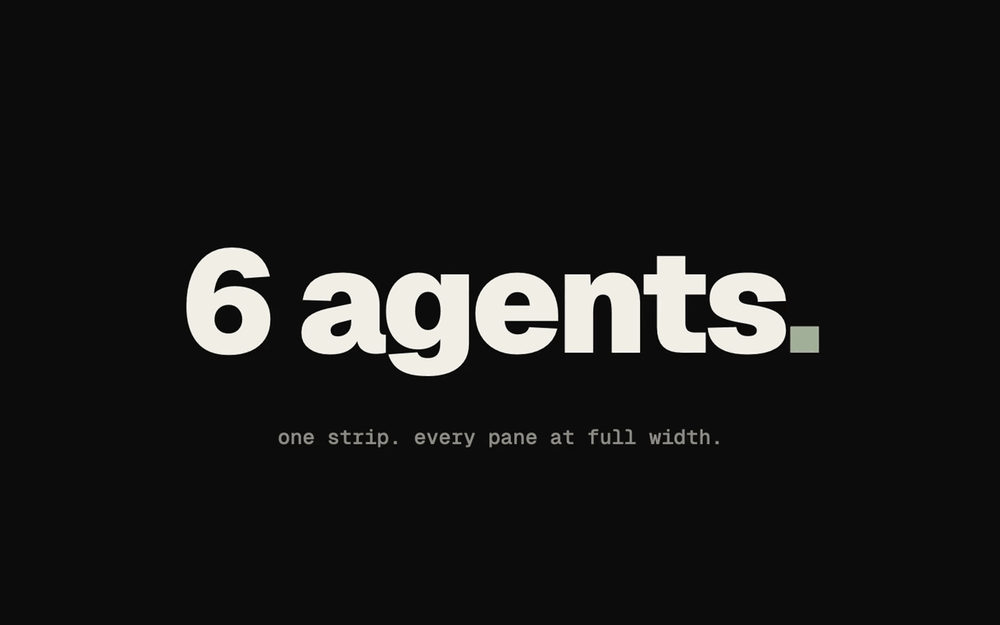

  

<h1 align="center">kansō</h1>

  
  
  
  

<b>More agents. Less babysitting.</b>

Every agent in a readable pane, the one waiting on you first, and a machine that lasts weeks. A layout for <a href="https://herdr.dev">Herdr</a>.

  

- Agents sit side by side, readable at their own width, and the one waiting on you comes first.
- Sleep a project and wake it on the same conversations.
- Memory, on macOS and Windows, recycles idle Claude sessions so the machine lasts weeks. Spend adds up across your computers once Sync is on.
- A Simulator sits beside the agent. kansō works on a space that lives on another computer.

For the Herdr desktop app, not the Herdr TUI. macOS, Windows and Linux; the iOS simulator and the Markdown file handler are macOS only.

  <a href="https://jlopezlira.github.io/herdr-kanso/">Website</a> ·
  <a href="#install">Install</a> ·
  <a href="#keys">Keys</a> ·
  <a href="#privacy">Privacy</a> ·
  <a href="CHANGELOG.md">Changelog</a>

## Install

Tell your agent: **`add herdr.dev/layouts/jlopezlira/herdr-kanso--kanso`**

Or, from a clone: `sh ./scripts/local-install.sh`. You need the Herdr app;
`gh` for the PR and Shipped panels; Node 22.15 or newer for Spend, Memory and
Simulator. Memory supports macOS and Windows; Windows uses its built-in
PowerShell and Task Scheduler without administrator rights. kansō updates
itself: a release shows as a row above Settings, and a click installs
it. Stable is what you get. Early, under What's new, also follows a beta
or a release candidate, and going back to Stable never installs an older
version. `ctrl-shift-l` goes back to your previous layout.
On Windows, merge `kanso/keys.windows.json` into your Herdr keys instead of
`kanso/keys.json`.

## What it does

  <a href="https://jlopezlira.github.io/herdr-kanso/">
    <picture>
      <source media="(prefers-color-scheme: light)" srcset="site/shots/hero-light.png">
      
    </picture>
  </a>

- **A strip, not a grid.** Terminals keep their width; a new pane opens beside
  you and the view glides to it. Pin a column, stack a server under an agent,
  1 to 8 columns per view.
- **Needs you first.** Cmd+J goes to the agent waiting on you, in any space.
  The sidebar shows every project, every agent's state and what it is on, and
  your conversations as threads.
- **Sleep and wake.** An agent, a tab or a project goes to sleep: it exits with
  its conversation kept, and wakes on it where it was. Sleep of a space on
  another computer stays on that computer, so the same tabs are asleep
  whichever computer you sit at, and waking from either works.
- **Images.** The newest picture the agent in focus made, big beside it,
  and a circle for each picture. Click a circle to switch. Click a spot to
  pin it and say what about it; ⌘↩ sends every note to the agent. Files,
  Preview and Images work for a space on another computer, and a note still sends.
- **Review without leaving.** Pull requests with diff, checks and threads, and
  one click to hand the feedback to an agent. Markdown files open to read and
  edit in place; `md-review plan.md` from an agent asks for your comments.
- **Take over in one key.** Cmd+Shift+O opens the agent's folder, worktree
  included, in your editor. Cmd+Alt+S hands a pane's work to another agent.
- **What your agents leave running.** Ports: dev servers and the panes that
  run them. Containers: Docker, with Up, Rebuild and Down per project.
  Worktrees: every one agents made, what removing it would lose, the disk back.
- **Weeks without a restart.** On macOS and Windows, the memory guard recycles
  bloated idle Claude agents on the same conversation; the Memory panel shows
  what it sees.
- **Spend and Shipped.** What your AI work is worth at list price, and what you
  delivered on GitHub, with share images that carry totals only. Turn Sync on
  from another computer's row and Spend adds that computer's tokens.
- **The device beside the agent.** Simulator shows an iOS simulator or an
  Android emulator: its screen, and touch, typing, Home, Lock, volume and
  rotate. Cmd+Shift+S opens it, and Ctrl+Shift+M on Windows.
  Nothing is downloaded until you press the button that installs serve-sim.
- **Keys you can see.** Cmd+? draws your keys on a keyboard, layer by modifier,
  and opens the hjkl dōjō, a game for vim's moves with a pixel pet.
- Two themes, `kanso` and `kanso-day`.

## Keys

The table is the macOS keys. Windows ships its own in
`kanso/keys.windows.json`: Ctrl and Alt, leaving the Windows key and AltGr
alone. Help follows the bindings you have.

| Keys | What they do |
|---|---|
| Cmd+1 … Cmd+9 | Go to pane 1 to 9 |
| Cmd+[ and Cmd+] | Previous and next pane |
| Cmd+D, Cmd+Alt+D, Cmd+Shift+D | New pane right, left, below |
| Cmd+W | Close the pane |
| Cmd+Shift+[ and Cmd+Shift+] | Move the pane left and right |
| Cmd+Shift+- and Cmd+Shift+= | Fewer or more panes per view |
| Cmd+Shift+Enter | Wider or narrower pane |
| Cmd+Alt+P | Pin the pane |
| Cmd+Shift+O | Open the pane's folder in an editor |
| Cmd+Alt+S | Send the pane's work to another agent |
| Cmd+Alt+T | Arrangements: save this tab, or open a saved one |
| Cmd+J | Next agent that needs you |
| Cmd+Alt+H/J/K/L | Between panes, as vim; Shift moves the pane |
| Cmd+? | kansō help, and the dōjō |
| Cmd+Shift+S | Simulator |

Every list answers j, k, gg, G, Enter, / and Esc. The gear at the end of the
tab bar rebinds kansō's own keys and hides the panels you don't use.

## Privacy

Everything runs on your machine, and reads only the folders you work in:
`git`, `gh`, `find`, `du`, `lsof`, `ps`, `sqlite3`, `node`, `npx`, `docker`,
`xcrun`, `adb`, `emulator` and Herdr's `hc`. What reaches the network: PR and
Shipped through `gh`, only while their panel is shown (Shipped keeps a private
gist of your own statistics); Spend's daily fetch of OpenRouter's price list;
and, only when you press the button, the install of `serve-sim` for Simulator.
Simulator otherwise stays on this computer. Threads and
Images read the agents' conversation files for the pictures
they printed; Spend reads the session files your AI tools write, for tokens and
prices. State lives under `~/.config/herdr-app/data/`. Nothing is sent to an
agent unless you press Send, and share images carry totals only.
[kanso/RECIPE.md](kanso/RECIPE.md) says what every part runs.

## Development

`npm test` (Node 22.15+, Git, Bash, sqlite3). Pull requests target `develop`.
A change to what kansō installs adds its entries to the next version's section
in [CHANGELOG.md](CHANGELOG.md), and raises
`kanso/mods/kanso-chrome/version.json` only when that category needs a bigger
bump than the section already has. `npm run check:version` checks it. `npm test` also checks each mod's imports
against the Herdr names in `tests/herdr-api.json` (`node scripts/herdr-api.mjs`
rewrites that file from this machine's declarations), and `npm run check:mods`
runs `herdr-app check` on every mod when the app is installed. A push
to `develop` publishes `vX.Y.Z-beta.N`, once CI passes on all three platforms,
when what kansō installs changed since the last beta or the newest stable tag. Running the Release candidate workflow
on `develop` publishes `vX.Y.Z-rc.N`. Merging `develop` into `main` publishes
the stable `vX.Y.Z`. Docs do not bump the version. How to work on it:
[CONTRIBUTING.md](CONTRIBUTING.md). How every part is built:
[kanso/RECIPE.md](kanso/RECIPE.md).

## Credits and license

Grown out of the mods shipped with Herdr; [NOTICE](NOTICE) says who changed
what. Contributors: Iván Campaña ([icampana](https://github.com/icampana)),
Leangseu Kim ([leangseu](https://github.com/leangseu), pull request prompts)
and Johannes Hund ([h0ru5](https://github.com/h0ru5), markdown reviews).
Apache License 2.0: [LICENSE](LICENSE).
