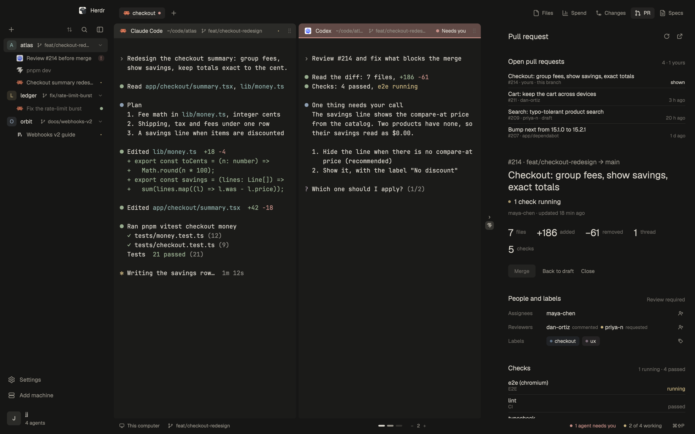

# Kanso

Kanso is a quiet Herdr layout for long days with coding agents. Warm stone
greys, no outlines, no decoration: the only text in full ink is the focused
pane's, and color appears only when an agent's state matters (working, needs
you, finished). Its second idea is that nothing you aren't looking at runs:
side panels exist only while open, and background checks slow down when the
window is behind others. Its third is an endless strip of panes, as in
Omarchy's scrolling layout: a new pane opens beside the focused one at its own
width, nothing shrinks, and the view slides to it. The name is the Japanese
principle of simplicity, removing what is not needed.

## What you see

Left to right, then top to bottom. Sizes are px at zoom 1.

- **Sidebar**, theme `chrome` (`#161615` dark, `#e3dfd6` light).
  - **Top strip**, 48 tall: empty. It holds the macOS traffic lights (at
    `[12, 16]`) and drags the window.
  - **Spaces** (`kanso-spaces`), filling the middle.
    - Open (256 wide): a 40-tall row with a + (New space) at the left, and
      Search and Hide sidebar at the right. Each is a 32 square with a 17 icon
      in `muted` that turns `foreground` on hover over a `foreground`+`12`
      wash.
    - Space rows are 32 tall with radius 8. Each starts with a 22 avatar
      (radius 7): the name's first letter, semibold 12, in the space's color
      over that color at alpha `26`. Then come the name (13, medium when
      active) and, right-aligned, the repo, branch and ahead/behind counts in
      11.5.
    - The active space has a `foreground`+`14` wash; hover shows
      `foreground`+`0c`.
    - Worktree spaces nest under their repo on 1px `input` guide lines.
    - A space's agents are listed under it in 28-tall rows: program icon 15,
      title 12.5, status mark at the right. The focused agent is in full ink
      over a `foreground`+`0c` wash; the others are `muted`, and idle ones
      `dim`.
    - Collapsed (76 wide): only the + and Hide buttons, stacked, then one
      centred 32 square per space holding its avatar. A 7 dot sits at its
      top-right corner when the space is blocked or done. The name shows in
      a tooltip.
  - **Footer** (`kanso-chrome`, `footer: true`), 156 tall, bottom-aligned:
    - Settings (gear) and Add machine (server icon), 34 tall, icon 17.
    - A 1px `border` divider.
    - An account chip: a 32 avatar (28 when collapsed) with the home folder
      name's first letter, then the name and "N agents".
    - Collapsed, each item is a centred square with its label as a tooltip.
      When an app update is ready, a 6 `accent` dot shows on Settings.
- **Work area**, padding 6, gap 4, on `chrome`.
  - **Inset card**: `background` fill, 1px `border`, radius 10, no shadow.
    - **Tab bar** (`kanso-tabs`), 48 tall, with a 1px `border` line under it.
      It drags the window.
      - Tabs are 26 tall with radius 7: program icon 15, name 12.5, then the
        tab's status. The active tab has a `foreground`+`12` wash and the
        rest are `muted`, with no borders and no tray behind them. A close x
        (13) shows on the active tab only when there is more than one tab.
      - After the tabs, a + (16 icon, 28 square) opens the shipped
        `new-menu`.
      - At the right are the panel buttons: Files, Insights, Changes and
        Specs. They are ghost buttons 26 tall (icon 15, text 12) with a wash
        when their panel is open. Insights and Specs show only when their
        mods are installed.
    - **Panes**: an endless canvas (`kanso-strip`). Panes sit side by side
      in columns. You choose how many fit in the view at once, 1 to 8
      (default 2): a new column takes 1/n of it, so on a wide screen you can
      hold 3, 4 or more side by side. A lone pane fills the view. Dragging
      the grip at a header's right edge resizes that column; its neighbour
      gives or takes the space (never under 8% of the view), the rest reflow,
      and the row grows or shrinks in pages. The view slides continuously
      over the row. A column cut by the edge shows that terminal's screen as
      dimmed text clipped at the edge (a "peek"; Herdr can't clip a live
      terminal), with a small pill naming what is behind the edge ("‹ zsh"). Off-screen columns aren't drawn. Horizontal only: one pane
      per column, always full height. A tab holding a mod pane falls back to
      Herdr's own split view.
      Each pane has a 34-tall header (`kanso-pane`, always shown):
      - Program icon 15 (75% opacity when unfocused) and the title, 12.5 in
        `foreground` and medium weight when focused, `muted` otherwise.
      - The folder (`~/...`) and branch (with a branch glyph) as plain 11.5
        text.
      - At the right, the pane's status. On hover the status gives way to
        open with (a terminal pane only), split right, split down, zoom and
        close (15 icons).
      - Terminal padding is `[14, 10]`.
    - **Side panel**, at the right of the panes: 368 wide (280 to 900),
      hidden by default. It holds whichever panel is open: `kanso-files`,
      `insights`, `kanso-changes` or `sdd-focused`.
  - **Status bar**, 26 tall: `kanso-status` with `{side: "left"}`, a
    180-wide minimap (`kanso-strip`) exactly in the middle, and
    `kanso-status` with `{side: "right"}`. The minimap is a centred row of
    soft pills, one per column (6 + 18 x its share wide, 4 tall, gap 3, no
    frame): `muted` whole in view, `dim` peeking, `input` off-screen,
    `foreground` focused. Click a pill to go there. After the pills, a tiny
    "− n +" control: fewer or more panes per view, and the number itself
    evens the columns out to 1/n.
    `kanso-status`, text 11.5 `muted`:
    - At the left, the machine (monitor or server icon, "This computer") and
      the branch.
    - At the right, "N agent(s) need you" in `blocked` with a dot (only when
      some agent is blocked), then a dot and "X of N working" (or "N agents
      idle" / "No agents"), then the palette shortcut "⌘⇧P" with the tooltip
      "Command palette".
- **Themes**: `kanso` (dark) and `kanso-day` (light), in `themes/`.
  - Dark: background `#1b1b19`, foreground `#d8d4cb`, chrome and canvas
    `#161615`, border `#272725`, input `#353430`, muted `#949086`, dim
    `#6b6862`, accent `#a3b09a`, working `#c4b07e`, blocked `#c99189`, done
    `#98ad8f`.
  - Light: background `#f4f1eb`, foreground `#3c3934`, chrome `#e3dfd6`,
    working `#8f7d52`, blocked `#9a6e68`, done `#6d7d62`.
- **Icons**: one Lucide-style set in `mods/kanso-chrome/icons/`, every one
  with the same stroke (2 on a 24 grid, 1.4 on a 16 grid), so they read as
  one family.

## How it behaves

- **Agent status**:
  - Working: a breathing dot in `working`, a 10px glyph cycling
    `· • ● •` every 450 ms (`.frames`). It shows on the tab, in the pane
    header, on the agent row and on the status bar dot. It is never a
    spinning icon.
  - Blocked: a `blocked` dot. The pane header adds the text "Needs you",
    the status bar says "N agent(s) need you", and a collapsed space shows
    its corner dot.
  - Done: a 6 `done` dot (tab, header, corner dot).
  - Idle: a 7 ring in `idle` on agent rows, with nothing on the tab or
    header.
- **Spaces**:
  - Click a space to select it. Clicking the space you are in folds or
    unfolds its agents; the folded state is kept.
  - Drag a space to reorder it (a 2px `accent` line shows where it lands).
    Right-click opens the shipped space menu.
  - Click an agent row to focus its pane.
- **Sidebar**:
  - Hide sidebar collapses it to a fixed 76 rail whose edge cannot be
    dragged.
  - Open, the edge drags between 200 and 480. The width you leave is
    remembered and used the next time you open it.
- **Tabs**:
  - Click selects a tab, drag reorders, double-click renames, and
    right-click opens the shipped tab menu.
  - Scrolling over the bar moves one tab per mouse-wheel notch, or per
    trackpad swipe (about 40px of travel).
- **The strip** (keys in `keys.json`, section `layout:kanso`; in Kanso they
  replace Herdr's tab keys, since the canvas is where you move):
  - Cmd+1 to Cmd+9 go to that pane; Cmd+[ and Cmd+] go to the previous and
    next one. The view glides to it (eases over about 0.3 s).
  - Cmd+D opens a pane to the right, Cmd+Shift+D to the left. The new pane is
    focused. The header's split button and the right-click menu do the same.
  - Cmd+W closes the focused pane. Cmd+Shift+[ and Cmd+Shift+] move it left
    and right. Cmd+Shift+Enter (or the header's zoom button) cycles its width
    1/4, 1/3, 1/2, 2/3, 1.
  - Cmd+Shift+- and Cmd+Shift+= show fewer or more panes per view (every
    column becomes 1/n, the focused one stays in view); Cmd+Shift+0 evens
    the columns out at the current count. `kanso-strip.per-N` sets N directly.
  - Kept as alternatives: Cmd+Alt+Left/Right or H/L (focus), with Shift
    (move), Cmd+Alt+1-9, Cmd+Alt+Home/End, Cmd+Alt+C (centre). Vertical keys
    (Cmd+Alt+Up/Down, Cmd+Alt+Enter) go to the program.
  - The wheel or a swipe over any pane header or the minimap slides the view
    continuously (600px of travel per view width) without moving the focus;
    if the focused pane slides out of full view, the keyboard moves to the
    nearest pane still whole. Cmd+Alt+, and Cmd+Alt+. slide a third of the
    view. Clicking a peek or a minimap mark slides to that pane.
  - Ctrl+drag a pane header onto another rearranges: the pane becomes a
    column beside the target, on the side it came from. The dragged header
    dims, and the target gets a wash.
- **Side panels, on demand**:
  - Clicking a panel button rewrites the panel stack to hold only that
    panel's block and shows it. Clicking it again, or closing the panel any
    other way, empties the stack. Herdr then ends that mod, and its timers,
    file watches and processes stop.
  - The open panel is remembered per space and restored when you switch
    spaces.
  - Files and Changes are idle whenever they aren't the shown panel.
  - The Specs count on its button shows only while Specs is open.
- **Background**:
  - While the window is behind others, the spaces list checks git every 5 s
    instead of every 0.5 s.
  - `hc machine ls` runs every 30 s with the window in front, and every
    2 min with it behind.

## Built from

- **Layout tree** (`layouts/kanso.json`), root `row`, `titlebar: "none"`,
  `traffic_lights: [12, 16]`, `resizable: true`, `terminal_menu: "kanso-menu"`:
  - `sidebar` (column, `chrome`, 256 px, min 200, max 480):
    - `brand`: block `kanso-chrome` (draws nothing), 48 px, `window_drag`.
    - `spaces`: block `kanso-spaces`.
    - `sidebar-footer`: block `kanso-chrome` with `{footer: true}`, 156 px.
  - `work` (column, padding 6, gap 4):
    - `inset` (`background`, border, radius 10):
      - `tabs`: block `kanso-tabs`, 48 px, `window_drag`.
      - `work-body` (row, `border` background, gap 1):
        - `main`: `{tab: "active"}` with the `kanso-pane` header (height 34)
          and no pane borders. `kanso-strip` replaces it with the canvas's
          columns (`strip-*` nodes) and puts it back for tabs it can't show.
        - `panel-body`: stack, 368 px (280 to 900), hidden, no children.
          `kanso-tabs` mounts the open panel in it.
    - `status-row` (row, 26 px): `status` (`kanso-status` `{side: "left"}`,
      weight 1), `strip-map` (`kanso-strip`, 180 px), `status-right`
      (`kanso-status` `{side: "right"}`, weight 1).
- **Mods**:
  - `kanso-spaces`: spaces, agents (`agents.js`), git per space via `exec`,
    machines via `hc machine ls`.
  - `kanso-tabs`: tabs, panel buttons and the on-demand panel mount via
    `layout.set`.
  - `kanso-strip`: the canvas. The copy in the status row is the controller
    and minimap; copies with `{filler: true}` paint free space and copies
    with `{peek, terminal, side, title}` draw a peek (`hc read` every 3 s). State per
    tab lives in shared `strip.state` (`{cols: [{panes, w}], vx, tx, n}`);
    the last chosen `n` is in shared `strip.n` for new tabs.
    Headers talk to it through shared `strip.req` (scroll, move, width),
    `strip.intent` (where the next new pane goes) and `strip.drag`.
  - `kanso-pane`: pane header.
  - `kanso-menu`: the terminal right-click menu (root `terminal_menu`):
    split right and left through the strip, width, right-clicks
    to the program, send back, "Open with…" (when the pane has a folder),
    close.
  - `open-with`: a popup (380 wide, at the top; 340 at the pointer from the
    menu and the header) that opens a folder in a code editor. Props
    `{folder, machine}`; without them, the focused pane's folder. It lists the
    editors found on this computer (macOS app folders, `command -v`, Flatpak),
    the last one used first (shared `open-with.recent`), with each app's own
    icon on macOS. Enter, 1 to 9 or a click opens; Esc leaves. Terminal
    editors open with `terminal.open {place: "right"}`. A folder on another
    machine opens over SSH in the VS Code family (`--remote ssh-remote+<machine>`)
    and Zed (`ssh://<machine>/<path>`); the rest show "local only".
    Cmd+Shift+O (`mod.open:open-with`, in `keys.json`) opens it.
  - `kanso-chrome`: sidebar footer, plus the icon set.
  - `kanso-status`: status bar.
  - `kanso-files`: lazy file tree via `sh`, git status marks.
  - `kanso-changes`: git diff and commit.
  - All are derived from Herdr's shipped mods (Apache-2.0) through the 0OZ
    and minimalistic forks, and all use `"place": "none"`.
- **Optional mods it can show, not included**: `sdd-focused` (Specs, by José
  Gutiérrez, from the minimalistic layout) and `insights` (cost analytics).
  When either is in `mods/`, its button appears.
- **Herdr functions**: `spaces`, `panes`, `agents`, `terminals`, `machines`,
  `layout`, `theme`, `shared`/`setShared`, `window`, `exec`, `hc`,
  `watchFolder`, `readTextFile`, `openOverlay`, `run`, `home`, `appHome`,
  `updates`.
- **Commands**: `layout.set`, `layout.resize`, `space.*`, `tab.*`, `pane.*`,
  `app.settings`, `app.palette`, `mod.open` (`picker`, `machine-add`,
  `open-with`), `terminal.open`.
- **Shipped overlays used**: `menu`, `new-menu`, `picker`, `machine-add`.
- **Programs run**: `git` (spaces, Files, Changes), `sh` (Files listing),
  `hc` (machines) and, for Open with, `sh`, `open`, `plutil` and `sips`
  (macOS) and the chosen editor. Nothing reaches the network.

## Watch out

- A layout may nest at most 16 levels (`layout.set` refuses deeper ones).
  Put the strip's columns directly in `work-body` (column > cell column >
  block), never inside another row.
- Herdr folds the layout on its own: empty containers go, containers with a
  single child are replaced by that child, and terminal blocks whose
  terminal ended go. Never rely on an empty column for space (use a filler
  block) or on a single-child wrapper's id. The side panel's toggle lives on
  `panel-body` itself for that reason.
- Herdr won't let a mod handle the mouse over terminal text, so reordering
  is Ctrl+drag on the pane headers, not on the terminal.
- A terminal block takes the keyboard on click, so `focused().pane` is null
  and implicit pane commands fail. Pass `pane` or `terminal` explicitly
  (`pane.split {pane}`, `pane.focus {terminal}`), and focus a new pane only
  once its block is in the layout.
- Herdr's own terminal menu passes a terminal block's id (`term-<pane>`) as
  its target pane, so its Split and Close fail with "no pane". Kanso ships
  its own menu, which finds the real pane from the clicked terminal.
- Cap layout writes: the strip writes only when its tree changes, and pauses
  itself for 10 s after 6 writes in 3 s, so a mistake can't keep the window
  busy.

- Never use `.spin()` for a busy state. It redraws the whole window about
  30 times a second while any agent works, and every redraw repaints every
  visible terminal. Use `.frames` with a slow period.
- A block stays alive while it is in the layout, even hidden. On-demand
  panels must be removed from the tree (`layout.set`), not only hidden.
  `kanso-tabs` reconciles: hidden with a child unmounts it, shown with none
  mounts the remembered panel. It waits up to 1 s for its own `layout.set`
  to land before reading the state as a choice.
- `layout.set` only works on a personal layout. Kanso is one once copied in,
  but the shipped `main` is not.
- The collapsed rail must be at least 76 wide on macOS, or the traffic
  lights overlap the tab bar. Its non-resizable state lives on the root row
  (`resizable`) together with the sidebar's `min`; `kanso-spaces` sets both
  with `layout.set` when you fold or open the sidebar, and once at start.
- Read `panes()`, `spaces()` and `layout()` once per render. Each read copies
  the whole list.
- Keep one-time fixes (`kanso.row`) in `init`, never in `render`.
- The macOS window layout (traffic lights, the empty top strip) assumes
  `titlebar: "none"`.
- Mod names are prefixed `kanso-`, so they can sit beside the minimalistic
  layout's `mn-*` mods.

## Done when

- Right-click a terminal, "Open with…": the popup names that pane's folder
  and lists the installed editors; picking one opens that folder in it.
- `herdr-app check` passes for all seven `kanso-*` mods and `open-with`, and
  `herdr-app status` shows no errors after `layout.switch {name: "kanso"}`.
- With no panel open, `panel-body` in the layout file has no children. After
  clicking Files it holds exactly one `files` block, and closing it empties
  it again.
- With the panel closed, no process started by Files, Changes or Insights is
  running.
- A working agent shows a breathing dot (not a spinner) on its tab, header
  and agent row. A blocked one shows "Needs you" in its header and in the
  status bar.
- Collapsed, the sidebar is 76 wide, its edge does not drag, and the traffic
  lights sit inside it. Opened, it drags between 200 and 480 and reopens at
  the width you left.
- One trackpad swipe over the tab bar moves exactly one tab.
- At 3 per view, Cmd+D three times from one pane gives four columns at a
  third each; the view slides to the new one and the minimap shows four
  pills. Cmd+Shift+= makes it 4 per view and all four fit; Cmd+Shift+- twice
  goes back to 2 per view with the focused pane still in view.
- Dragging a header grip 200px right on a 1200px view moves that divider by
  a sixth of the view and the next column shrinks by the same.
- Cmd+Alt+Left past the first column in view slides the view.
  Cmd+Shift+Enter makes the focused column 2/3 wide without changing any
  other column.
- Ctrl+dragging one header onto another moves that pane beside it.
