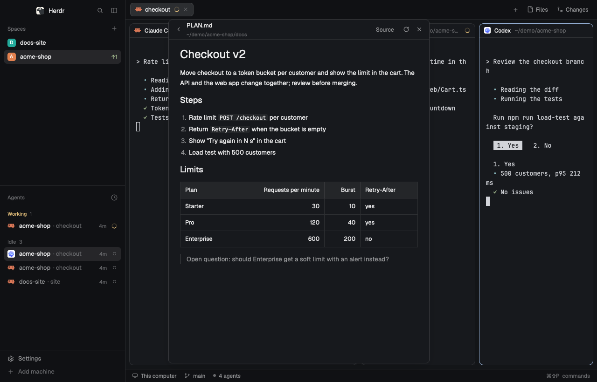

# Markdown panel

The plans, notes and reviews your agents write, in a window over any layout:
formatted, and edited where they read. Double-click a paragraph, a list or a
heading to edit just that block while the rest stays formatted; a table opens
as a grid of cells. What you type is saved as you go, and never over a change
an agent made to the file meanwhile: you choose which stays. Cmd+Shift+M
opens it with the Markdown files of the focused pane's folder; once Kanso
Markdown is the app for `.md` files, a Cmd-click on a path in a terminal opens
the file here instead of in Xcode or another editor. It comes from the
[Kanso](https://github.com/jlopezlira/herdr-kanso) layout, which shows the same
document in its side panel.

This file is the brief: enough to build the mod from an empty folder. The
files next to it are one build of it.

## What you see

- A window (`kind: "window"`), 560 wide and 90% of Herdr's height, on the
  theme's `background`, text 13 px. It stays open until closed, doesn't dim
  Herdr, and opens where you last dropped it (`key: "markdown-panel"`).
- **Header**, 42 tall, 10 side padding, a 1 px `border` line under it:
  - with a file: a back chevron, the file's name (semibold) over its folder
    (11, `dim`; `~/...` under your home), then the saving state (11.5, `dim`:
    "Edited", "Saving…", "Saved"; "Read only" for a file on another machine;
    "Too large to edit" past 400,000 characters), "Source" (or "Formatted"
    while it is on), Read again, and Close;
  - with none: "Markdown" over the folder, and Close.
- **The document**, scrolling, at most 760 wide, 16 side padding, 10 between
  blocks. Each block (a heading, a paragraph, a list, a quote, a table, a
  code fence, a rule) is drawn by `TextView.markdown` on its own, in a box
  with 8 side padding and radius 6 that shows `hover` under the pointer.
  YAML front matter shows as a `yaml` code block.
- **The block being edited** replaces its drawing: a `Textarea` on `raised`
  with an `input` border, growing with its text (1 to 40 rows):
  - a heading without its `#`, at its own size (22, 18, 16, 15, 14, 13.5 for
    levels 1 to 6), semibold;
  - code and front matter in the terminal's font at 12.5;
  - anything else at 13.5, as Markdown.
- **A table being edited**: a grid in an `input` border, radius 6, scrolling
  sideways when narrow (columns at least 96 wide). Header cells on `raised`,
  semibold; every cell a `Textarea` (1 to 8 rows) with a `border` line on its
  right. A × above each column and at the end of each row removes it; under
  the grid, "Add row", "Add column" and "Done".
- **A conflict**: a bar under the header, "The file changed on disk while you
  edited it." in `blocked`, with "Keep mine" (`solid`) and "Take the file's".
- **The list** (no file open): one row per Markdown file in the folder, 30
  tall, the name then its subfolder (11.5, `dim`); "Looking for Markdown…"
  while it looks; "No Markdown files in this folder. Cmd-click a .md path in
  a terminal to read it here." when there are none. Above it, when the
  focused terminal mentioned any, "From this terminal" (11, `dim`) with those
  files, the name then its folder, and "In this folder" over the rest.

## How it behaves

- Cmd+Shift+M (`mod.open:markdown-panel`) opens and closes it.
- The folder is the focused pane's current folder, else your home. The list
  is `git ls-files -- '*.md' '*.markdown' '*.mdx'` there, else `find` 3 deep
  (skipping `node_modules`), at most 40, shallowest first. A click opens one.
- A pane on another machine (an SSH machine in `hc machine ls`): the list
  and the file come from that machine (`exec` and `readTextFile` with `on`,
  the space's `machine`), its folder shown as `machine: folder`. The file
  can be edited there. It does not save while you type; leaving it writes it.
  It is read again every 3 seconds (`watchFolder` watches only this computer).
- **Editing**: a double-click on a block opens it; a double-click below the
  last block adds a paragraph there. Escape, or a double-click on another
  block, closes it, and the document is split into blocks again (an empty
  line you typed makes two paragraphs). A single click does nothing, so text
  reads and selects as text.
- **Saving**: on this computer, 700 ms after the last change,
  `writeTextFile(path, text, expected)` with the text as last read or written.
  On another computer it does not save while you type. Before showing another
  file or closing, it saves first.
- **Conflicts**: a save the file refuses, or a change read from disk while
  yours is unsaved, shows the conflict bar. "Keep mine" writes yours over
  it; "Take the file's" drops yours. Nothing is written until you choose.
- **Live**: the file's folder is watched (`watchFolder`); while you aren't
  editing, the document follows the file, so an agent writing a plan shows
  up as it writes.
- **Links**: `http(s)` and `mailto` open in the browser; a link to another
  `.md` (relative to the document, `#anchor` dropped) opens here.
- **Source** edits the whole file in an `Editor` (`language: "markdown"`,
  soft wrap, no line numbers), saved the same way.
- **Escape** leaves the block being edited; with none open it saves and
  closes the window. It is a key binding (`cx.bind_keys`, contexts
  `MarkdownPanel` and `MarkdownPanel > Input`, action `markdown_panel_escape`),
  since a focused `Textarea` takes Escape before `on_key_down`.
- **From this terminal**: when the window opens, `recent.sh <terminal>` (the
  focused pane's) lists up to 15 existing Markdown files above the folder's,
  best first: a path on the clipboard, paths in `hc read <terminal>` from
  newest to oldest, then the `*.md` in the scratchpad of a Claude Code session
  in that terminal. The list then has two headings, "From this terminal" and
  "In this folder". Not for a pane on another machine.
- **Reviews**: `md-review <file>` (in the mod's folder; link it into your
  `PATH`) records itself in `data/markdown-review-waiting/<pid>.path`, leaves
  the path in `data/markdown-review/` to open it, opens the window unless
  `herdr-app status` lists it, and waits. While a live `md-review` waits on a
  file, the file shows **Done** in the header (12 px on `raised`, a `border`
  line, radius 6, tooltip "Review done: tell the agent"), also after the
  window was closed and opened again. Done saves, answers every `md-review`
  waiting on that file with `data/markdown-review-done/<pid>`, then shows the
  next review waiting or closes; each `md-review` prints `Review done:
  <path>` and a `diff -u` of what you changed, removes its files, and exits.
  With no file shown, the list starts with "Waiting for your review". A
  step `md-review` can't take (writing its files, opening the window) makes
  it exit 1 and say why, instead of waiting.
  Outside Herdr (`HC_TERMINAL_ID` unset) it exits 2 and says so.
  `md-review --rule` prints a short rule for agents, only inside Herdr: add it
  to an agent's instructions yourself (for Claude Code, a `SessionStart` hook
  running `md-review --rule`) if you want agents to ask for reviews this way.
- **From outside Herdr**: the mod watches `data/kanso-open/` (under
  `appHome()`), takes the newest `*.path` file there, removes them all, and
  opens that path.

## Built from

- **One mod**, `mods/markdown-panel/`:
  - `main.js`: the window, the list, the inbox;
  - `doc.js`: the document (`MarkdownDoc`): reading, blocks, editing, saving,
    conflicts, drawing;
  - `blocks.js`: Markdown as blocks of whole lines that join back to the file
    byte for byte; tables to cells and back (escaped pipes kept, alignment
    row kept);
  - `markdown-handler.sh`: Kanso Markdown, below;
  - `md-review`: the review command; `recent.sh`: the "From this terminal"
    search (`hc`, `python3`, `pbpaste` or `wl-paste`);
  - `icons/`: `close`, `refresh`, `chevron-left` (16 px strokes);
  - `mod.json`: `{ "place": "none", "title": "Markdown", "overlay": {
    "kind": "window", "width": 560, "height": 0.9, "key": "markdown-panel" } }`.
- **One key**, in `keys.json`: `"global": { "cmd-shift-m":
  "mod.open:markdown-panel" }`.
- `herdr` functions: `readTextFile`, `writeTextFile`, `watchFolder`, `exec`,
  `appHome`, `focused`, `home`, `props`, `closeOverlay`, `theme`, `settings`.
- `gpui-base`: `TextView.markdown`, `Textarea` / `TextareaState`, `Editor` /
  `EditorState`.

## Kanso Markdown (macOS, optional)

A Cmd-click on a file path in a terminal goes from Herdr to macOS, which opens
the file in its app for `.md` (often Xcode). `sh
~/.config/herdr-app/mods/markdown-panel/markdown-handler.sh install` makes a
small app, `~/Applications/Kanso Markdown.app`, the app for `.md` files:

- for each file, it writes the path to `data/kanso-open/<time>-<pid>.path`,
  opens this mod with `herdr-app do mod.open` when it isn't open (and the
  layout isn't Kanso, which shows the file in its own panel), and brings
  Herdr to the front;
- when Herdr isn't running, it opens the file in TextEdit;
- `... markdown-handler.sh uninstall` gives `.md` back to the app it had.

It is an AppleScript app (`osacompile`) with its bundle id set to
`dev.kanso.markdown`, `LSUIElement`, a document type for
`net.daringfireball.markdown`, signed ad hoc, registered with `lsregister`,
and made the default with `LSSetDefaultRoleHandlerForContentType` (through
`swift`, so it needs Xcode or its Command Line Tools).

## Watch out

- It writes only the file you edit, and only after a change you made.
- A file on another machine does not save while you type. Leaving it writes it.
- Blocks are drawn one by one, so a reference-style link whose definition is
  in another block shows as text.
- `TextView` takes the mouse inside a block, so editing is a double-click on
  the block (`on_mouse_down` with `click_count === 2`), not a click.
- Create `TextareaState` and `EditorState` in event handlers or `init`,
  never in `render`, and release them when the block closes.

## Done when

- `herdr-app check mods/markdown-panel` reports nothing.
- Cmd+Shift+M lists the folder's Markdown; a click shows one formatted.
- In a pane on an SSH machine, Cmd+Shift+M lists that machine's Markdown
  and a click shows it, ready to edit.
- A double-click on a paragraph shows only that paragraph's text; typing
  saves within a second ("Saved"); Escape shows it formatted again.
- A double-click on a table shows the grid; "Add row" adds one to the file.
- Changing the file from a terminal while a block has unsaved text shows the
  conflict bar, and the file is untouched until you choose.
- With Kanso Markdown installed, `open some.md` shows it in the window.

## Credits

Reviews with `md-review` and Done, Escape, and "From this terminal" are by
Johannes Hund ([h0ru5](https://github.com/h0ru5)), from his remix
[herdr-md-review](https://github.com/h0ru5/herdr-md-review).
