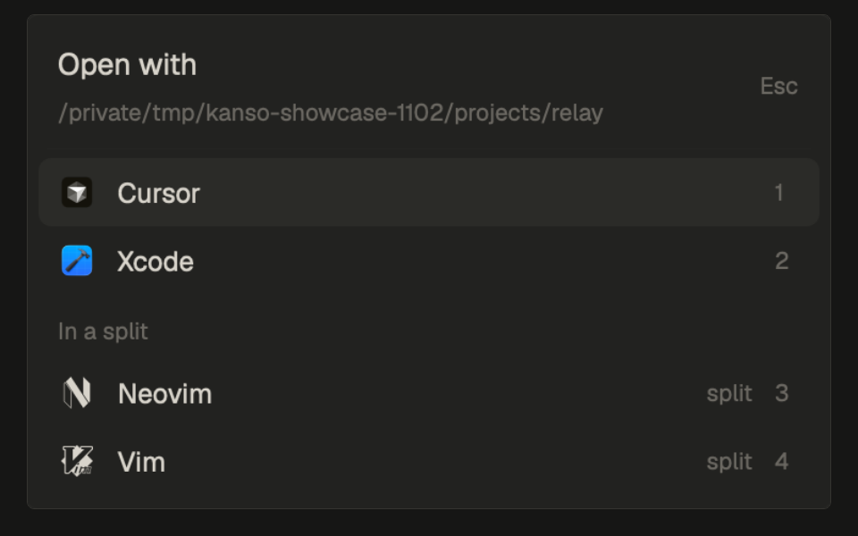

# Open with

Cmd+Shift+O opens a small picker at the top of the window that opens the
focused pane's folder in a code editor installed on this computer. It finds
your editors by itself (Cursor, VS Code, Zed, Windsurf, Antigravity, Kiro,
Sublime Text, the JetBrains IDEs, Xcode and more), puts the last one you used
first, and opens Neovim, Helix or Vim in a split beside the pane. A folder on
another machine opens over SSH in the VS Code family and Zed. This is a piece
you add to your own layout, not a whole window. It comes from the
[Kanso](https://github.com/jlopezlira/herdr-kanso) layout, which also opens it
from the pane header, the right-click menu and its Files panel.

This file is the brief: enough to build the mod from an empty folder. The
files next to it are one build of it.

## What you see

- A popup 380 wide, at the top of the window, 40 below the top edge, on the
  theme's `popover` background, with 6 of padding. Text is 12.8 px.
- **Header** (9 side padding, 6 top, 8 bottom): "Open with" (14, semibold,
  `foreground`) over the folder (11, `dim`, truncated). A folder under your
  home shows as `~/...`; a folder on another machine shows as
  `<machine>: <path>`. "Esc" (11, `dim`) sits at the right.
- A 1 px line in `border`, 4 in from each side, 4 above the list.
- **The list**, up to 420 tall, scrolling past that. One row per editor
  found, 32 tall, 9 side padding, 10 gap, radius 6:
  - an 18 px glyph: the app's own icon on macOS (a 64 px PNG made from its
    `.icns`); else Herdr's shipped icon for Cursor, Antigravity, Kiro,
    Neovim, Helix and Vim (`icons/<id>.svg`, 15 px, `foreground`); else a
    rounded tile in one of six colors with the name's first letter (10.5,
    bold, white);
  - the name, truncated;
  - a hint (11, `dim`): "last used" on the most recent one, "split" on a
    terminal editor, "local only" on an editor that can't open another
    machine's folder;
  - the number that picks it, 1 to 9 (11, `dim`, 12 wide).
- GUI editors come first, then an "In a split" heading (11, `dim`, 8 above,
  4 below) and the terminal editors. Within each group, the last used come
  first (up to 12 remembered), then the catalog order.
- The selected row has the `selected` background; a hover shows `hover`.
  Rows that can't open the folder are `dim` and can't be picked.
- Before the search ends: "Looking for editors…". With none found: "No code
  editor found. Install Cursor, VS Code, Zed or another editor and open this
  again." If the search fails: "Could not look for editors: <error>" in
  `blocked`.

## How it behaves

- Cmd+Shift+O (`mod.open:open-with`) opens it; pressing it again closes it.
  It takes the keyboard at once.
- The folder is the focused pane's current folder, else the pane's, else the
  space's folder, else your home. The machine is the space's machine.
- Up and Down move the selection (wrapping, skipping rows that can't open);
  Enter opens the selected one; 1 to 9 open that row; a click opens a row;
  Esc closes. Keys with Ctrl, Cmd or Alt pass through.
- Opening closes the popup first, then:
  - macOS app: `open -a <app> <folder>`.
  - Command line (Linux, or no app bundle): the CLI, detached (`setsid -f`,
    or `nohup ... &`). A Flatpak-only editor: `flatpak run <id> <folder>`.
  - Windows: `Start-Process` through PowerShell, every path quoted.
  - Terminal editor: a new terminal to the right of the pane, in that
    folder, running `<editor> .`.
  - Another machine: VS Code family with `--remote ssh-remote+<machine>
    <folder>`, Zed with `ssh://<machine>/<folder>`; a terminal editor runs by
    name on that machine. The rest show "local only".
- A launch that fails shows an error notification with the editor's output.
- The editors found are cached (shared `open-with.found`), so the list shows
  at once next time while it looks again.
- No agent statuses, animations or timers.

## Built from

- **One mod**, `mods/open-with/`: `main.js` and `mod.json`
  (`{ "place": "none", "title": "Open with", "overlay": { "kind": "popup",
  "at": "top", "offset": 40, "width": 380 } }`).
- **One key**, in `keys.json`: `"global": { "cmd-shift-o":
  "mod.open:open-with" }`.
- **Props** (all optional): `{ folder, machine }` to open a given folder, or
  `{ file }` (a full path) to open that file instead. Other mods open it with
  `openOverlay({ mod: "open-with", kind: "popup", at: "top", width: 380,
  props: { folder, machine } })`.
- **The catalog**: one entry per editor with its macOS bundle names, its
  CLIs, its Flatpak id, its family (`vscode` or `zed`, for SSH) and the CLI
  inside its macOS bundle (`Contents/Resources/app/bin/<cli>` for the VS Code
  family, `Contents/MacOS/cli` for Zed).
- **Detection**, one `sh` pass: each app name in `/Applications`,
  `~/Applications`, `/Applications/Setapp` and `~/Applications/JetBrains
  Toolbox`; each CLI with `command -v` (absolute paths only); and `flatpak
  list --app` when Flatpak exists. On Windows, `where <cli>` for each CLI.
- **Icons** (macOS only): `plutil` reads `CFBundleIconFile` from the app's
  `Info.plist`, `sips -Z 64` makes a PNG under
  `~/.config/herdr-app/data/open-with/icons/<id>.png`, once per app.
- `herdr` functions: `exec`, `run("terminal.open", {argv, folder, place:
  "right"})`, `notify`, `theme`, `props`, `closeOverlay`, `focused`,
  `panes`, `spaces`, `home`, `appHome`, `shared`, `setShared`, `window`
  (for the platform).

## Watch out

- It runs programs: `sh` (to detect editors and launch them), `open`,
  `plutil`, `sips`, `flatpak`, `where` and `powershell`. It reads app folders
  and writes only under `data/open-with/`. It never reaches the network.
- Paths are passed as arguments, never pasted into a shell string; on
  Windows every PowerShell quote character (U+0027 and U+2018 to U+201B) is
  doubled.
- Inside Kanso, a text file passed as `{ file }` gets one more row first,
  "Preview in the panel", which needs Kanso's `kanso-panel` and `panel-body`
  node. On its own the mod never receives a file from Cmd+Shift+O, so that
  row doesn't show.
- `icons/<id>.svg` are Herdr's shipped icons; a fresh build should not copy
  them into the mod.
- Linux CLIs can stay attached to the process that started them: detach
  them, or closing Herdr closes the editor.

## Done when

- `herdr-app check mods/open-with` reports nothing.
- Cmd+Shift+O shows the popup with the focused pane's folder and the editors
  installed here; Cmd+Shift+O again closes it.
- 1 opens the first editor on that folder, and it moves to the top next time
  with "last used".
- Neovim (if installed) opens in a new terminal to the right, in the folder.
- On a space on another machine, VS Code or Zed opens the folder over SSH and
  the other GUI editors are dimmed with "local only".
- Esc closes it without opening anything.
